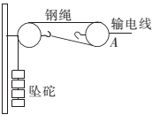

# Physics - 题目 2810

**ID**: acafbca266cf4b3abcacdb59d8e88127
**年级**: Grade 8
**难度**: Medium
**题型**: Fill-in-the-blank

## 题目
高速铁路的输电线，无论冬、夏都绷得直直的，以保障列车电极与输电线的良好接触。​​​​​​​‌图为输电线的牵引装置。钢绳通过滑轮组悬挂坠砣，其中定滑轮的作用是；不计滑轮和钢绳自重及摩擦，若要使输电线A端受到的拉力大小为1×10^{4}N，则坠砣受到的总重力为N，若某段时间内坠砣串下降了30cm，则输电线A端向左移动了cm（不考虑钢绳的热胀冷缩）。

## 解答

1. 定滑轮的实质是等臂杠杆，不能省力，只能改变力的方向。
2. 滑轮组绳子股数n=2，输电线A端受到的拉力大小为1×10^{4}N，不计滑轮和钢绳自重及摩擦，则坠砣受到的总重力为
3. G= $\frac {F}{n}=\frac {1\times 10{^{4}}{\rm{N}}}{2}$ =5000N
4. 滑轮组绳子股数n=2，坠砣串下降30cm，则输电线A端向左移动的距离为
5. s'= $\frac {s}{n}=\frac {30cm}{2}$ =15cm

## 知识点

**中文**:
  - 定滑轮及其工作特点
  - 滑轮组及其工作特点

**English**:
  - Fixed Pulleys and Operating Characteristics
  - Pulley Systems and Operating Characteristics

---
