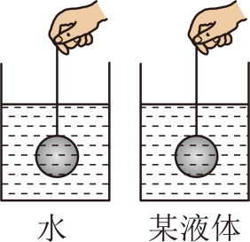

# Physics - 题目 1286

**ID**: c67418f7a9cf41d3b3cfbf8baad235e6
**年级**: Grade 8
**难度**: Medium
**题型**: Fill-in-the-blank

## 题目
小敏用橡皮筋系着体积为 $2\times {{1}}{{0}}{^{{{-}}{{3}}}}{\rm{m}}{^{{{3}}}}$ 的金属球先后浸没在水中、某液体中，手提橡皮筋上端，待球静止后现象如图所示。​​​​​​​‌金属球在水中受到的浮力为N；若某液体的密度为 $ρ{{}_{液}}$ ，则 $ρ{{}_{水}}$$ρ{{}_{液}}$ 。（选填“>”、“<”或“=”）

## 解答

1. 金属球在水中受到的浮力为 $F{{}_{浮}}=ρ{{}_{水}}V{{}_{排}}g=1.0\times 10{^{3}}{\rm{k}}{\rm{g}}/{\rm{m}}{^{3}}\times 2\times 10{^{{{-}}3}}{\rm{m}}{^{3}}\times {{1}}{{0}}{\rm{N}}{\rm{/}}{\rm{k}}{\rm{g}}=20{\rm{N}}$ ，由图得，金属球在液体中时，橡皮筋的伸长量较大，则橡皮筋在液体中对金属球的拉力较大，金属球浸没在水与液体中，均处于静止状态，金属球均受到竖直向下的重力、竖直向上的拉力与竖直向上的浮力作用处于平衡状态，则金属球受到的浮力为 $F{{}_{浮}}{\rm{=}}G-F{{}_{拉}}$ ，则金属球在水中受到的浮力较大，金属球排开水与液体的体积相等，由 $F{{}_{浮}}=ρ{{}_{液}}V{{}_{排}}g$ 得， $ρ{{}_{水}}>ρ{{}_{液}}$ 。

## 知识点

**中文**:
  - 二力及多力平衡的判断和应用
  - 阿基米德原理的应用

**English**:
  - Judgment and Application of Equilibrium of Forces
  - Applications of Archimedes' Principle

---
