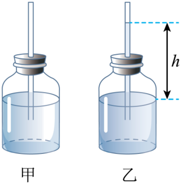

# Physics - 题目 2521

**ID**: c7150b5a1c804b59981ed94775e4e19a
**年级**: Grade 8
**难度**: Medium
**题型**: Fill-in-the-blank

## 题目
卓玛学习了大气压强之后，用密度为p的液体自制了气压计，气压计放在一楼时，细玻璃管内外液面相平，如图（甲）所示，她乘坐电梯到达顶楼时，细玻璃管内液面上升的高度为h，如图（乙）所示。​​​​​​​‌液面上升的原因是随高度的增加，大气压强变；已知到达顶楼时瓶内气压为p，请你用题中的物理量符号表示顶楼的大气压强（结果还需用到符号g）。

## 解答

1. 将自制气压计从一楼拿到顶楼时，瓶内的气压不变，而外界气压减小，所以细玻璃管中液面上升，说明大气压随着高度的增大而变小。
2. 顶楼时瓶内气压为p，细玻璃管内水柱的高度为h，则根据p等于细玻璃管内液体柱产生的压强与外界大气压强p_{0}的和可得外界大气压强为p_{0}=p-ρgh。

## 知识点

**中文**:
  - 大气压强与高度的关系
  - 大气压的应用

**English**:
  - Relationship between Atmospheric Pressure and Altitude
  - Applications of Atmospheric Pressure

---
