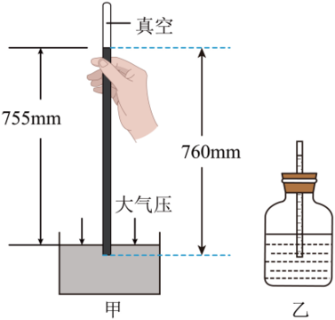

# Physics - 题目 218

**ID**: c799cad731224702b15298999567d5b7
**年级**: Grade 8
**难度**: Medium
**题型**: Fill-in-the-blank

## 题目
如图所示是小明进行托里拆利实验时的测量数据，当时当地的大气压强相当于mm水银柱产生的压强；​​​​​​​‌若将玻璃管从竖直位置适当向右倾斜，则玻璃管内、外水银柱的高度差（选填“变大”、“不变”或“变小”）；若将乙装置移到高山顶上，则管内液体会（选填“上升”、“不变”或“降低”）

## 解答

1. 由图可知，玻璃管内水银面到水银槽中水银面的垂直高度为755mm，所以，当时的大气压强等于755mm高水银柱产生的压强，即755mmHg。
2. 玻璃管倾斜时，管中水银柱长度将增大，高度不变。则玻璃管内、外水银柱的高度差不变。
3. 大气压随高度的增加而减小，所以，移到高山顶上去做此实验，则测量结果将变小，管内液体会降低。

## 知识点

**中文**:
  - 大气压强与高度的关系
  - 大气压强的测量及标准大气压

**English**:
  - Relationship between Atmospheric Pressure and Altitude
  - Measurement of Atmospheric Pressure & Standard ATM

---
