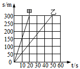

# Physics - 题目 871

**ID**: d558e3b8100b42f283ab56ae0fefad5a
**年级**: Grade 8
**难度**: Medium
**题型**: Fill-in-the-blank

## 题目
甲、乙两辆汽车在水平路面上同时同地向东匀速行驶，路程—时间图像如图所示，则甲车的运行速度是m/s，t=20s时，乙车通过的路程为m。​​​​​​​‌

## 解答

1. 由图像可知，甲的路程—时间图像是一条过原点的直线，且行驶300m，用时20s，
2. $v{{}_{甲}}=\frac {s{{}_{甲}}}{t{{}_{甲}}}{\rm{=}}\frac {300{\rm{m}}}{20{\rm{s}}}=15{\rm{m}}{\rm{/}}{\rm{s}}$
3. 由图像可知，乙的路程—时间图像是一条过原点的直线，且行驶300m，用时50s，
4. $v{{}_{乙}}=\frac {s{{}_{乙}}}{t{{}_{乙}}}{\rm{=}}\frac {300{\rm{m}}}{50{\rm{s}}}=6{\rm{m}}{\rm{/}}{\rm{s}}$
5. 由于乙是匀速运动，所以t=20s时，乙车通过的路程为
6. $s^{′}{{{}_{乙}}}=v{{}_{乙}}t{\rm{=}}6{\rm{m}}{\rm{/}}{\rm{s}}\times 20{\rm{s}}=120{\rm{m}}$

## 知识点

**中文**:
  - 速度公式及其应用

**English**:
  - Velocity Formula and Applications

---
