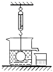

# Physics - 题目 22

**ID**: f29abbc0437748d2ab825c5be322c76c
**年级**: Grade 8
**难度**: Medium
**题型**: Fill-in-the-blank

## 题目
如图所示，将悬挂在弹簧测力计上的实心铝球浸没在装满水的溢水杯中，铝球静止时，弹簧测力计的示数为3.4N，那么铝球的体积为m^{3}，铝球浸没在水中时所受到的浮力为N（已知铝的密度为ρ_{铝}=2.7×10^{3}kg/m^{3}）。​​​​​​​‌

## 解答

1. 实心铝球浸没在水中静止时，则铝球排开水的体积
2. V_{排}=V_{球}
3. 铝球受到的浮力
4. F_{浮}=ρ_{水}gV_{排}=ρ_{水}gV_{球}
5. 实心铝球的重力
6. G=mg=ρ_{铝}gV_{球}
7. 由于铝球受力平衡，则
8. G=F_{浮}+F_{拉}
9. ρ_{铝}gV_{球}=ρ_{水}gV_{球}+F_{拉}
10. 即
11. 2.7×10^{3}kg/m^{3}×10N/kg×V_{球}=1×10^{3}kg/m^{3}×10N/kg×V_{球}+3.4N
12. 故铝球的体积
13. V_{球}=V_{排}=2×10^{-4}m^{3}
14. 由 $F{{}_{浮}}{\rm{=}}ρ{{}_{液}}V{{}_{排}}g$ 知道，铝球受到的浮力
15. F_{浮}=ρ_{水}gV_{球}=1.0×10^{3}kg/m^{3}×10N/kg×2×10^{-4}m^{3}=2N

## 知识点

**中文**:
  - 二力及多力平衡的判断和应用
  - 阿基米德原理的应用

**English**:
  - Judgment and Application of Equilibrium of Forces
  - Applications of Archimedes' Principle

---
