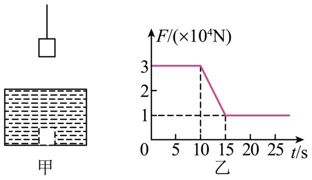

# Physics - 题目 1697

**ID**: 0702405d7d6c4ed19a01b2652ac3ca35
**年级**: Grade 8
**难度**: Medium-Hard
**题型**: Calculation

## 题目
被誉为世界桥梁建设奇迹的港珠澳大桥于2018年10月24日正式通车运营，图甲是建设过程中用钢索拉着实心长方体建筑材料沿竖直方向、以0.4m/s的速度匀速下降的情景。​​​​​​​‌图乙是建筑材料下沉到水底之前钢索对它的拉力F随时间t变化的图像，t=0时开始投放，t=25s时投放结束。ρ_{水}=1.0×10^{3}kg/m^{3}，g取10N/kg，水的阻力可以忽略不计，求：（1）长方体建筑材料完全浸没在水中时所受的浮力；（2）长方体建筑材料的密度；（3）投放结束时长方体建筑材料顶部受到水的压强。

## 解答

1. 解：（1）由图乙可以看出，当时间为t=15s时，浮力大小不再改变，此时建筑材料完全浸没在水中，此时受的浮力
2. F_{浮}=G﹣F_{拉}_{1}=3×10^{4}N﹣1×10^{4}N=2×10^{4}N
3. （2）由F_{浮}=ρgV_{排}得建筑材料的体积
4. $V=V{{}_{排}}=\frac {F{{}_{浮}}}{ρ{{}_{水}}g}=\frac {2\times 10{^{4}}{\rm{N}}}{1.0\times 10{^{3}}{\rm{k}}{\rm{g}}{\rm{/}}{\rm{m}}{^{3}}\times 10{\rm{N}}{\rm{/}}{\rm{k}}{\rm{g}}}=2{\rm{m}}{^{3}}$
5. 由图乙可知，建筑材料的重力G=3×10^{4}N，由
6. G=mg=ρVg
7. 得建筑材料的密度
8. $ρ{{}_{件}}=\frac {G}{gV}=\frac {3\times 10{^{4}}N}{10{\rm{N}}{\rm{/}}{\rm{k}}{\rm{g}}\times 2{\rm{m}}{^{3}}}=1.5\times 10{^{3}}{\rm{k}}{\rm{g}}{\rm{/}}{\rm{m}}{^{3}}$
9. （3）由图乙读出建筑材料完全在水中下落的时间
10. t_{2}=25s﹣15s=10s
11. 由 $v=\frac {s}{t}$ 得顶部到水面的深度
12. h=vt=0.4m/s×10s=4m
13. 顶部受到水的压强
14. p=ρgh=1×10^{3}kg/m^{3}×10 N/kg×4m=4×10^{4}Pa
15. 答：（1）长方体建筑材料完全浸没在水中时所受的浮力为2×10^{4}N；
16. （2）长方体建筑材料的密度为1.5×10^{3}kg/m^{3}；
17. （3）投放结束时长方体建筑材料顶部受到水的压强为4×10^{4}Pa。

## 知识点

**中文**:
  - 浮力大小的计算
  - 速度公式及其应用
  - 液体压强计算公式的应用
  - 阿基米德原理的应用

**English**:
  - Calculation of Buoyancy
  - Velocity Formula and Applications
  - Application of Liquid Pressure Formula
  - Applications of Archimedes' Principle

---
