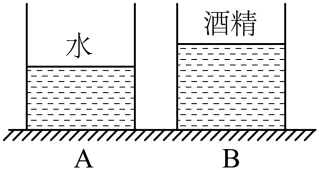

# Physics - 题目 281

**ID**: 136ffe2b31734389a479a108d1ac7f6a
**年级**: Grade 8
**难度**: Medium-Hard
**题型**: Calculation

## 题目
如图所示，两个完全相同圆柱形容器A和B放在水平桌面上，容器的底面积为 $2\times 10{^{﹣2}}{\rm{m}}{^{2}}$ ，容器内水的深度为0.2m，且两容器中水和酒精的质量相等。​​​​​​​‌（已知 $ρ{{}_{酒精}}=0.8\times 10{^{3}}{\rm{k}}{\rm{g}}{\rm{/}}{\rm{m}}{^{3}}$ ， $ρ{{}_{铁}}=7.9\times 10{^{3}}{\rm{k}}{\rm{g}}{\rm{/}}{\rm{m}}{^{{{3}}}}$ ， $ρ{{}_{铝}}=2.7\times 10{^{3}}{\rm{k}}{\rm{g}}{\rm{/}}{\rm{m}}{^{3}}$ ）（1）求A容器中水的质量m_{水}。（2）求B容器中酒精的体积V_{酒精}。（3）将5400g铝块浸没在水中，质量未知的铁块浸没在酒精中后，发现两个容器中的液面一样高，求铁块的质量。

## 解答

1. 解：（1）容器中水的体积 $V{{}_{水}}=Sh{{}_{水}}=2\times 10{^{﹣2}}{\rm{m}}{^{3}}\times 0.2{\rm{m}}=4\times 10{^{﹣3}}{\rm{m}}{^{3}}$ ，水的质量
2. $m{{}_{水}}=ρ{{}_{水}}V{{}_{水}}=1.0\times 10{^{3}}{\rm{k}}{\rm{g}}{\rm{/}}{\rm{m}}{^{8}}\times 4\times 10{^{﹣3}}{\rm{m}}{^{3}}=4{\rm{k}}{\rm{g}}$
3. （2）B容器中酒精的质量 $m{{}_{酒精}}=m{{}_{水}}=4{\rm{k}}{\rm{g}}$ ，则酒精的体积 $V{{}_{酒精}}=\frac {m{{}_{酒精}}}{ρ{{}_{酒精}}}=\frac {4kg}{0.8\times 10{^{3}}{\rm{k}}{\rm{g}}{\rm{/}}{\rm{m}}{^{3}}}=5\times 10{^{﹣3}}{\rm{m}}{^{3}}$
4. （3）5400克的铝块的体积 $V{{}_{铝}}=\frac {m{{}_{铝}}}{ρ{{}_{铝}}}=\frac {5400\times 10{^{-3}}{\rm{k}}{\rm{g}}}{2.7\times 10{^{3}}{\rm{k}}{\rm{g}}{\rm{/}}{\rm{m}}{^{3}}}=2\times 10{^{﹣}}{^{3}}{\rm{m}}{^{3}}$ ，因为两个容器中的液面一样高，且液体均没有溢出，所以 $V{{}_{铝}}+V{{}_{水}}=V{{}_{铁}}+V{{}_{酒精}}$ ，铁块的体积 $V{{}_{铁}}=V{{}_{铝}}+V{{}_{水}}﹣V{{}_{酒精}}=2\times 10{^{﹣3}}{\rm{m}}{^{3}}+4\times 10{^{-3}}{\rm{m}}{^{3}}-5\times 10{^{﹣3}}m{^{3}}=1\times 10{^{-3}}{\rm{m}}{^{3}}$ ，则铁块的质量 $m{{}_{铁}}=ρ{{}_{铁}}V{{}_{铁}}=7.9\times 10{^{3}}{\rm{k}}{\rm{g}}{\rm{/}}{\rm{m}}{^{3}}\times 1\times 10{^{﹣}}{^{3}}{\rm{m}}{^{3}}=7.9{\rm{k}}{\rm{g}}$

## 知识点

**中文**:
  - 密度综合计算

**English**:
  - Comprehensive Density Calculations

---
