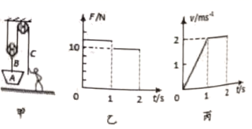

# Physics - 题目 664

**ID**: 17560b2e7f944c0ea2c3ac6498a31ad0
**年级**: Grade 8
**难度**: Medium-Hard
**题型**: Calculation

## 题目
小张同学用如图甲所示装置将重18N的空吊篮A提升到一定高度，绳子C能承受的最大拉力为40N，施加的拉力F随时间t变化关系如图乙所示，A上升的速度v随时间t变化关系如图丙所示，忽略绳重及摩擦。​​​​​​​‌求：（1）动滑轮的重力；（2）第2s内拉力F的功率；（3）该装置提升重物时的最大机械效率。

## 解答

1. 解：（1）由图甲、乙、丙三图知，1~2s内，吊篮A匀速直线运动，其速度为2m/s，绳子C的拉力为10N，滑轮组承重绳子的根数为2，忽略绳重及摩擦时，有
2. G_{动}=2F-G_{A}=2×10N-18N=2N
3. （2）第2s内拉力F的功率
4. P=Fv=10N×2m/s=20W
5. （3）由题意知，绳子C的最大拉力
6. F_{1}=40N
7. 则此滑轮组能提升的最大物重
8. G_{1}=2F_{1}-G_{动}=2×40N-2N=78N
9. 那么最大机械效率
10. $η=\frac {W{{}_{有}}}{W{{}_{总}}}=\frac {G{{}_{1}}h}{Fs}=\frac {G{{}_{1}}}{2F}=\frac {78N}{2\times 40N}=97.5\%$
11. 答：（1）动滑轮的重力为2N；
12. （2）第2s内拉力F的功率为20W；
13. （3）该装置提升重物时的最大机械效率为97.5%。

## 知识点

**中文**:
  - 力与图像的结合
  - 速度的图像问题
  - 功率的计算和估算
  - 滑轮组绳子拉力的计算
  - 滑轮（组）的机械效率及其计算

**English**:
  - Force and Graphs
  - Velocity-Time Graphs
  - Calculation and Estimation of Power
  - Calculating Rope Tension in Pulley Systems
  - Mechanical Efficiency of Pulleys and Calculations

---
