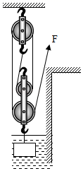

# Physics - 题目 1488

**ID**: 27e7cb78327f438a9666de539229e444
**年级**: Grade 8
**难度**: Medium-Hard
**题型**: Calculation

## 题目
如图所示，用滑轮组提升浸在水中的实心圆柱形物体，物体始终浸没在水中，已知物体的高度为0.8m，底面积为0.15m^{2}，重为2000N，10秒内匀速上升了6m，此过程中作用在绳端的拉力F做功为6000J；（不计绳重、摩擦及水的阻力）求：（1）10秒内，绳子自由端移动的速度大小；（2）物体浸没在水中时受到的浮力大小；（3）物体浸没在水中匀速上升时，绳端受到的拉力大小；（4）物体浸没在水中匀速上升时，滑轮组的机械效率。​​​​​​​‌

## 解答

1. 解：（1）由图可知，n＝4，绳子自由端移动的距离
2. $s＝4h＝4\times 6{\rm{m}}＝24{\rm{m}}$
3. 则绳子自由端移动的速度为
4. $v=\frac {s}{t}=\frac {24{\rm{m}}}{10{\rm{s}}}{\rm{=}}2.4{\rm{m}}/{\rm{s}}$
5. （2）实心圆柱形物体的体积为
6. $V＝Sh{{}_{柱}}＝0.15{\rm{m}}{^{2}}\times 0.8{\rm{m}}＝0.12{\rm{m}}{^{3}}$
7. 因为物体浸没在水中，所以物体排开液体的体积为
8. $V排＝V＝0.12{\rm{m}}{^{3}}$
9. 所以物体浸没在水中时受到的浮力为
10. $F{{}_{浮}}＝ρ{{}_{液}}gV{{}_{排}}＝1\times 10{^{3}}{\rm{k}}{\rm{g}}/{\rm{m}}{^{3}}\times 10{\rm{N}}/{\rm{k}}{\rm{g}}\times 0.12{\rm{m}}{^{3}}＝1200{\rm{N}}$
11. （3）因为物体浸没在水中匀速上升时，作用在绳端的拉力F做的功W_{总}＝6000J，所以绳端受到的拉力为
12. $F=\frac {W{{}_{总}}}{{\rm{s}}}{\rm{=}}\frac {6000{\rm{J}}}{24{\rm{m}}}{\rm{=}}250{\rm{N}}$
13. （4）因为物体浸没在水中匀速上升时，处于平衡状态，受力平衡，所以动滑轮对物体的拉力为
14. $F{{}_{动}}＝G﹣F{{}_{浮}}＝2000{\rm{N}}﹣1200{\rm{N}}＝800{\rm{N}}$
15. 所以滑轮组做的有用功为
16. $W{{}_{有用}}＝F{{}_{动}}h＝800{\rm{N}}\times 6{\rm{m}}＝4800{\rm{J}}$
17. 所以滑轮组的机械效率为
18. $η{\rm{=}}\frac {W{{}_{有}}}{W{{}_{总}}}{\rm{=}}\frac {4800{\rm{J}}}{6000{\rm{J}}}\times 100{\rm{\%}}{\rm{=}}80{\rm{\%}}$
19. 答：（1）10秒内，绳子自由端移动的速度大小为2.4m/s；
20. （2）物体浸没在水中时受到的浮力大小为1200N；
21. （3）物体浸没在水中匀速上升时，绳端受到的拉力大小为800N；
22. （4）物体浸没在水中匀速上升时，滑轮组的机械效率为80%。

## 知识点

**中文**:
  - 有用功、额外功和总功的计算
  - 速度公式及其应用
  - 阿基米德原理的应用
  - 滑轮（组）的机械效率及其计算

**English**:
  - Calculation of Useful, Extra, and Total Work
  - Velocity Formula and Applications
  - Applications of Archimedes' Principle
  - Mechanical Efficiency of Pulleys and Calculations

---
