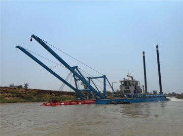

# Physics - 题目 2241

**ID**: 2f4e029a04ad4a8280af0364b2e87bc2
**年级**: Grade 8
**难度**: Medium-Hard
**题型**: Calculation

## 题目
如图是一种用于河道清淤的绞吸挖泥船，其工作原理是利用转动的绞刀绞松河底的淤泥和土壤，与水混合成泥浆，经吸泥泵吸入泵体并经过排泥管送至高处的排泥区。​​​​​​​‌某型号绞吸挖泥船部分技术参数如表所示。（g取10N/kg）船体总质量/t吸泥泵额定功率P/KW最大排泥流量Q/（ ${\rm{m}}{^{3}}{\rm{m}}{\rm{i}}{\rm{n}}{^{-1}}$ ）最大扬程h/m吃水深度/m80303201.8（1）求吸泥泵正常工作船底受到水的压强。（2）求在非工作状态下静止在水面的绞吸挖泥船浸入水中的体积。（3）某次吸泥泵正常工作时，排泥流量为每分钟 $2.5{\rm{m}}{^{{{3}}}}$ ，排泥扬程（将河底泥浆提起的高度）为18m，泥浆的密度为 $1.6\times 10{^{3}}{\rm{k}}{\rm{g}}{\rm{/}}{\rm{m}}{^{3}}$ ，求吸泥泵此次工作时的机械效率。

## 解答

1. 解：（1）根据题意可知，绞吸挖泥船吃水深度为1.8m，由 $p=ρgh$ 可得，吸泥泵正常工作船底受到水的压强为 $p=ρgh=1.0\times 10{^{3}}{\rm{k}}{\rm{g}}{\rm{/}}{\rm{m}}{^{{{3}}}}\times 10{\rm{N}}{\rm{/}}{\rm{k}}{\rm{g}}\times 1.8{\rm{m}}=1.8\times 10{^{4}}{\rm{P}}{\rm{a}}$ 。
2. （2）由二力平衡知，漂浮在水面的绞吸挖泥船受到的浮力为 $F{{}_{浮}}=G{{}_{船}}=m{{}_{船}}g=80\times 10{^{3}}{\rm{k}}{\rm{g}}\times 10{\rm{N}}{\rm{/}}{\rm{k}}{\rm{g}}=8\times 10{^{5}}{\rm{N}}$ ，由阿基米德原理 $F{{}_{浮}}=ρ{{}_{液}}V{{}_{排}}g$ 知，绞吸挖泥船浸入水中的体积为 $V{{}_{排}}=\frac {F{{}_{浮}}}{ρ{{}_{液}}g}=\frac {8\times 10{^{5}}{\rm{N}}}{1.0\times 10{^{3}}{\rm{k}}{\rm{g}}{\rm{/}}{\rm{m}}{^{{{3}}}}\times 10{\rm{N}}{\rm{/}}{\rm{k}}{\rm{g}}}=80{\rm{m}}{^{{{3}}}}$ 。
3. （3）吸泥泵1min排泥质量 $m=1.6\times 10{^{3}}{\rm{k}}{\rm{g}}{\rm{/}}{\rm{m}}{^{3}}\times 2.5{\rm{m}}{^{{{3}}}}{\rm{/}}{\rm{m}}{\rm{i}}{\rm{n}}\times 1{\rm \min }=4\times 10{^{3}}{\rm{k}}{\rm{g}}$ ，吸泥泵lmin做的有用功为 $W{{}_{有}}=Gh=mgh=4\times 10{^{3}}{\rm{k}}{\rm{g}}\times 10{\rm{N}}{\rm{/}}{\rm{k}}{\rm{g}}\times {{2}}{{0}}{\rm{m}}=8\times 10{^{5}}{\rm{J}}$ ，吸泥泵lmin做的总功为 $W{{}_{总}}=Pt{{}_{1}}=30\times 10{^{3}}{\rm{W}}\times 60{\rm{s}}=1.8\times 10{^{6}}{\rm{J}}$ ，则吸泥泵此次工作时的机械效率为 $η=\frac {W{{}_{有}}}{W{{}_{总}}}\times 100\%=\frac {8\times 10{^{5}}{\rm{J}}}{1.8\times 10{^{6}}{\rm{J}}}\times 100\%\approx 44.4\%$ 。
4. 答：（1）吸泥泵正常工作船底受到水的压强为 $1.8\times 10{^{4}}{\rm{P}}{\rm{a}}$ ；
5. （2）在非工作状态下静止在水面的绞吸挖泥船浸入水中的体积为 $80{\rm{m}}{^{{{3}}}}$ ；
6. （3）吸泥泵此次工作时的机械效率为44.4%。

## 知识点

**中文**:
  - 其他机械的机械效率及其计算
  - 液体压强的大小及其计算
  - 阿基米德原理的应用
  - 有用功、额外功和总功的计算

**English**:
  - Mechanical Efficiency of Other Machines
  - Magnitude and Calculation of Liquid Pressure
  - Applications of Archimedes' Principle
  - Calculation of Useful, Extra, and Total Work

---
