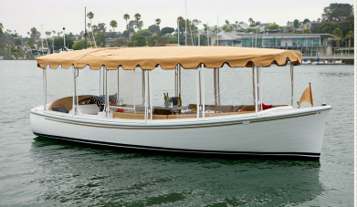

# Physics - 题目 974

**ID**: 4463252cfd0c4aa694ce32ff45c60739
**年级**: Grade 8
**难度**: Medium-Hard
**题型**: Calculation

## 题目
如图为公园游玩常用的观光船，为了保护环境一般采用电力驱动。​​​​​​​‌这种游船满载时，船和人的总质量为280kg，已知水的密度为 $1.0\times 10{^{3}}{\rm{k}}{\rm{g}}/$ m³。（g取10N/kg）求：（1）该游船满载时，船底最深处距离水面 $0.5{\rm{m}}$ ，该处所受水的压强；（2）该游船满载时，游船排开水的体积；（3）该游船满载时，在平静的湖面上以 $1.5{\rm{m}}/{\rm{s}}$ 的速度匀速行驶，此时游船所受水的阻力为 $400{\rm{N}}$ ，驱动电机的工作电压为 $60{\rm{V}}$ ，且消耗的电能有 $80\%$ 用来克服水的阻力做功，求此时驱动电机的工作电流。

## 解答

1. 解：（ $1$ ）游船满载时，船底最深处所受水的压强
2. $p=ρ{{}_{水}}gh=1.0\times 10{^{3}}{\rm{k}}{\rm{g}}/{\rm{m}}{^{3}}\times 10{\rm{N}}/{\rm{k}}{\rm{g}}\times 0.5{\rm{m}}=5\times 10{^{3}}{\rm{P}}{\rm{a}}$
3. 即船底最深处所受水的压强为 $5\times 10{^{3}}{\rm{P}}{\rm{a}}$ 。
4. （2）游船处于漂浮状态，则游船满载时受到的浮力等于船和人的总重力
5. $F{{}_{浮}}=G{{}_{总}}=m{{}_{总}}g=280{\rm{k}}{\rm{g}}\times 10{\rm{N}}/{\rm{k}}{\rm{g}}=2.8\times 10{^{3}}{\rm{N}}$
6. 由F_{浮}=ρ_{水}gV_{排}得游船排开水的体积
7. V_{排}= $\frac {F{{}_{浮}}}{ρ{{}_{水}}g}$ = $\frac {2.8\times 10{^{3}}{\rm{N}}}{1.0\times 10{^{3}}{\rm{k}}{\rm{g}}/{\rm{m}}{^{3}}\times 10{\rm{N}}/{\rm{k}}{\rm{g}}}$ =0.28m^{3}
8. 即该游船满载时，游船排开水的体积为0.28m^{3}。
9. （3）因为游船匀速行驶，由
10. P= $\frac {W}{t}$ = $\frac {Fs}{t}$  =Fv
11. 可知，游船克服水的阻力做功的功率
12. $P{{}_{机械}}=Fv=400{\rm{N}}\times 1.5{\rm{m}}/{\rm{s}}=600{\rm{W}}$
13. 由η= $\frac {P{{}_{机械}}}{P{{}_{电}}}$ 得驱动电机消耗的电能做功的功率
14. P_{电}= $\frac {P{{}_{机械}}}{η}$ = $\frac {600{\rm{W}}}{80\%}$ =750W
15. 由 $P=UI$ 可知，此时驱动电机的工作电流
16. I= $\frac {P^{′}}{U}$ = $\frac {750{\rm{W}}}{60{\rm{V}}}$ =12.5A
17. 即驱动电机的工作电流为12.5A。
18. 答：（1）该游船满载时，船底最深处所受水的压强为 $5\times 10{^{3}}{\rm{P}}{\rm{a}}$ ；
19. （2）该游船满载时，游船排开水的体积为0.28m^{3}；
20. （3）驱动电机的工作电流为12.5A。

## 知识点

**中文**:
  - 其他机械的机械效率及其计算
  - 液体压强的大小及其计算
  - 阿基米德原理的应用
  - 物体的浮沉条件及其应用
  - 功率的计算和估算
  - 电功率的计算及应用

**English**:
  - Mechanical Efficiency of Other Machines
  - Magnitude and Calculation of Liquid Pressure
  - Applications of Archimedes' Principle
  - Floating/Sinking Conditions and Applications
  - Calculation and Estimation of Power
  - Calculation and Application of Electric Power

---
