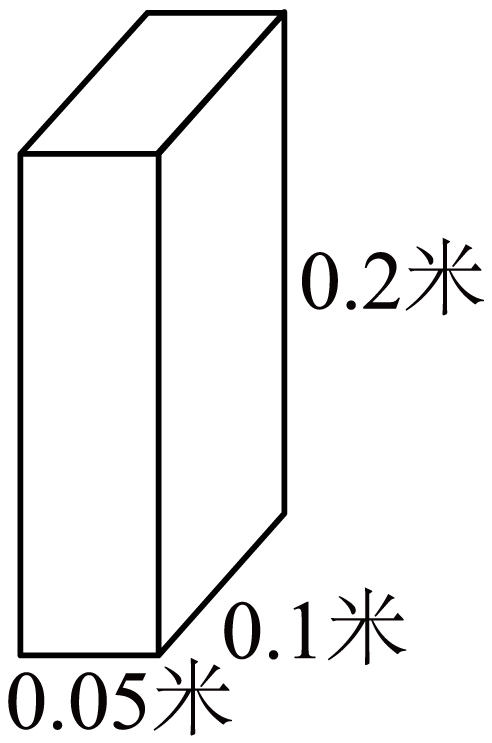

# Physics - 题目 370

**ID**: 476cad2dba0f4f56bb83f0718b5219ae
**年级**: Grade 8
**难度**: Medium-Hard
**题型**: Calculation

## 题目
如图所示，竖放在水平地面上的长方体，三条棱长分别为0.2米、0.1米、0.05米，密度为 $2\times 10{^{3}}{\rm{k}}{\rm{g}}/{\rm{m}}{^{3}}$ 。​​​​​​​‌（1）求该长方体的质量m；（2）求竖放时长方体对水平地面的压强p；（3）为了使该长方体对水平地面的压强为500帕，拟采取的方法有：将长方体平放或侧放后，沿水平方向在上部切去一定质量 $Δm$ 。若要使切去的质量 $Δm$ 较小，请说明采取的放置方法及理由，并求出 $Δm$ 的较小值 $(g=10{\rm{N}}/{\rm{k}}{\rm{g}})$ 。

## 解答

1. 解：（1）该长方体的体积
2. V=abh=0.2m×0.1m×0.05m=1×10^{-3}m^{3}
3. 由密度公式可得，该长方体的质量
4. m=ρV=2×10^{3}kg/m^{3}×1×10^{-3}m^{3}=2kg
5. （2）因物体对水平面的压力和自身的重力相等，所以，该长方体对水平地面的压强
6. $p=\frac {F}{S}=\frac {G}{S}=\frac {mg}{S}=\frac {2{\rm{k}}{\rm{g}}\times 10{\rm{N}}{\rm{/}}{\rm{k}}{\rm{g}}}{0.05{\rm{m}}\times 0.1{\rm{m}}}=4000{\rm{P}}{\rm{a}}$
7. （3）由题意可知，要使该长方体对水平地面的压强为500Pa，且沿水平方向在上部切去一定质量 $Δm$ 较小，根据
8. $p=\frac {F}{S}=\frac {G}{S}=\frac {mg}{S}$
9. 可知，应使长方体对水平地面产生压强的受力面积最大，即将长方体平放，此时长方体剩余部分的重力即对水平地面的压力
10. G′=F′=p′S=p′ab=500Pa×0.2m×0.1m=10N
11. 长方体剩余部分的质量
12. $m^{′}=\frac {G^{′}}{g}=\frac {{{1}}{{0}}{\rm{N}}}{{{1}}{{0}}{\rm{N}}{\rm{/}}{\rm{k}}{\rm{g}}}{\rm{=}}{{1}}{\rm{k}}{\rm{g}}$
13. 则
14. ${\rm{Δ}}m=2{\rm{k}}{\rm{g}}{{-}}{{1}}{\rm{k}}{\rm{g}}{\rm{=}}{{1}}{\rm{k}}{\rm{g}}$
15. 答：（1）求该长方体的质量m为2kg；
16. （2）竖放时长方体对水平地面的压强为4000Pa；
17. （3）要使该长方体对水平地面的压强为500帕，将长方体平放后沿水平方向在上部切去的质量 $Δm$ 最小，原因是：根据
18. $p=\frac {F}{S}=\frac {G}{S}=\frac {mg}{S}$
19. 可知，长方体对水平地面产生压强的受力面积越大，切去的质量 $Δm$ 较小，其 $Δm$ 的较小值为1kg。

## 知识点

**中文**:
  - 固体压强的判断与计算
  - 密度公式的应用

**English**:
  - Determination and Calculation of Solid Pressure
  - Application of Density Formula

---
