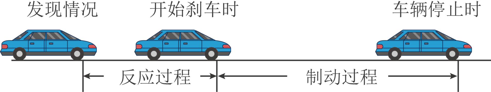

# Physics - 题目 1087

**ID**: 48ae7173361c48dfa1f8b76fc8b721d6
**年级**: Grade 8
**难度**: Medium-Hard
**题型**: Calculation

## 题目
汽车遇到紧急情况停车要经历反应和制动两个过程。​​​​​​​‌汽车在反应过程中做匀速直线运动，在制动过程做变速直线运动。如图所示，某司机驾车前行，突然发现前方66m处有障碍物。平时司机从发现险情到刹车制动需要的反应时间为0.5s，这段时间内汽车保持原速匀速前行了12m。汽车制动后还要继续向前滑行21m，用时2.5s才能停下。求：（1）汽车制动前的速度是多少km/h？（2）汽车整个过程的平均速度是多少m/s？（3）若司机酒后驾车，反应时间是平时的4倍，请通过计算判断汽车是否会撞上障碍物。

## 解答

1. 解：（1）汽车制动前的速度是 $v{{}_{1}}=\frac {s{{}_{1}}}{t{{}_{1}}}=\frac {12{\rm{m}}}{0.5{\rm{s}}}=24{\rm{m}}/{\rm{s}}=86.4{\rm{k}}{\rm{m}}/{\rm{h}}$
2. （3）若司机酒后驾车，反应时间是平时的4倍，请通过计算判断汽车是否会撞上障碍物。
3. （2）汽车整个过程的平均速度是 $v=\frac {S{{}_{总{{ }}}}}{t{{}_{总{{ }}}}}=\frac {S{{}_{1}}+S{{}_{2}}}{t{{}_{1}}+t{{}_{2}}}=\frac {12{\rm{m}}+21{\rm{m}}}{0.5{\rm{s}}+2.5{\rm{s}}}=11{\rm{m}}/{\rm{s}}$
4. （3）若司机酒后驾车，司机制动前后汽车行驶的距离为 $s=12{\rm{m}}\times 4+21{\rm{m}}=69{\rm{m}}{\rm{>}}{{6}}{{6}}{\rm{m}}$
5. 所以汽车会撞上
6. 答：（1）汽车制动前的速度是86.4km/h；
7. （2）汽车整个过程的平均速度是11m/s；
8. （3）该司机会撞上障碍物。

## 知识点

**中文**:
  - 平均速度及其计算
  - 速度的综合计算

**English**:
  - Average Velocity and Calculation
  - Comprehensive Velocity Calculations

---
