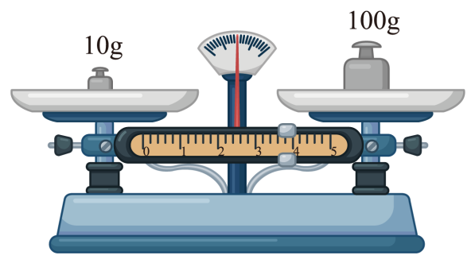

# Physics - 题目 511

**ID**: 52c37453175d4cdb8c4b369cd89af2e3
**年级**: Grade 8
**难度**: Medium-Hard
**题型**: Calculation

## 题目
镁合金材料具有硬度高、密度小、抗疲劳性强度高和耐腐蚀等优点，被广泛用于国防、工程和日常生活中。​​​​​​​‌某兴趣小组获得两块一样的，边长为4厘米的正方体空心镁合金工艺品。其中一块工艺品内部空心部分充满了水，同学们用实验室托盘天平测量其质量时，由于天平所配的20克的砝码遗失，同学们将10克的砝码和空心装满水的镁合金工艺品一起放入天平左盘后将天平调节平衡（如图所示）。另一块工艺品内部空心部分充满了酒精，称量后发现该工艺品质量比充水的那块质量少5.4克。（已知 $ρ{{}_{水}}=1.0\times 10{^{3}}{\rm{k}}{\rm{g}}/{\rm{m}}{^{3}}$ ， $ρ{{}_{酒精}}=0.8\times 10{^{3}}{\rm{k}}{\rm{g}}/{\rm{m}}{^{3}}$ ）求：（1）充水后的该工艺品质量；（2）该工艺品内部空心部分体积；（3）制成该工艺品的镁合金的密度。

## 解答

1. 解：（1）由图中可知，充水后该工艺品与砝码的质量和为
2. $m{{}_{总}}=100{\rm{g}}+3.6{\rm{g}}=103.6{\rm{g}}$
3. 故可知充水后该工艺品的质量为
4. $m=m{{}_{总}}-m{{}_{码}}=103.6{\rm{g}}-10{\rm{g}}=93.6{\rm{g}}$
5. （2）设空心部分体积为V，由密度相关知识可得
6. $\left ({ρ{{}_{水}}-ρ{{}_{酒精}}}\right )V=5.4{\rm{g}}$
7. 解得该工艺品内部空心部分的体积为
8. $V=\frac {5.4{\rm{g}}}{ρ{{}_{水}}-ρ{{}_{酒棈}}}=\frac {5.4{\rm{g}}}{1{\rm{g}}/{\rm{c}}{\rm{m}}{^{3}}-0.8{\rm{g}}/{\rm{c}}{\rm{m}}{^{3}}}=27{\rm{c}}{\rm{m}}{^{3}}$
9. （3）由题意可知，该镁合金质量为
10. $m{{}_{镁}}=m-ρ{{}_{水}}V=93.6{\rm{g}}-1.0{\rm{g}}/{\rm{c}}{\rm{m}}{^{3}}\times 27{\rm{c}}{\rm{m}}{^{3}}=66.6{\rm{g}}$
11. 镁合金体积为
12. $V{{}_{镁}}=V{{}_{总}}-V={\left({4{\rm{c}}{\rm{m}}}\right)^{3}}-27{\rm{c}}{\rm{m}}{^{3}}=37{\rm{c}}{\rm{m}}{^{3}}$
13. 故可知制成该工艺品的镁合金密度为
14. $ρ{{}_{镁}}=\frac {m{{}_{镁}}}{V{{}_{镁}}}=\frac {66.6{\rm{g}}}{37{\rm{c}}{\rm{m}}{^{3}}}=1.8{\rm{g}}/{\rm{c}}{\rm{m}}{^{3}}$
15. 答：（1）充水后的该工艺品质量为93.6g；
16. （2）该工艺品内部空心部分的体积为27cm^{3}；
17. （3）制成该工艺品的镁合金的密度为1.8g/cm^{3}。

## 知识点

**中文**:
  - 空心、混合物质的密度计算

**English**:
  - Density Calculation of Hollow/Mixed Substances

---
