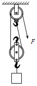

# Physics - 题目 2156

**ID**: 535f14d21f3b4541bfc419629f6b3257
**年级**: Grade 8
**难度**: Medium-Hard
**题型**: Calculation

## 题目
用如图的滑轮组将重60N的货物匀速提升1m的过程中，所用拉力F=40N，不计绳重及摩擦．求：(1)上述过程中的有用功；​​​​​​​‌(2)上述过程中提升动滑轮所做的功；(3)若用该滑轮组匀速提起80N的货物，该滑轮组的机械效率 $η$ 为多大．

## 解答

1. (1)有用功：
2. $W=Gh=6{\rm{0}}{\rm{N}}\times {\rm{1}}{\rm{m}}=6{\rm{0}}{\rm{J}}$ ；
3. (2)由图可知，n=2，则绳端移动的距离：
4. $s=nh=2\times {\rm{1}}{\rm{m}}={\rm{2}}{\rm{m}}$ ，
5. 拉力做的总功：
6. $W=Fs=4{\rm{0}}{\rm{N}}\times {\rm{2}}{\rm{m}}=8{\rm{0}}{\rm{J}}$ ，
7. 不计绳重及摩擦，提升动滑轮所做的额外功：
8. $W{{}_{额}}=W{{}_{总}}-W{{}_{有}}=8{\rm{0}}{\rm{J}}-{\rm{6}}{\rm{0}}{\rm{J}}=20{\rm{J}}$ ；
9. (3)由 $W{{}_{额}}=G{{}_{动}}h$ 可得动滑轮重力：
10. $G{{}_{动}}=\frac {W{{}_{额}}}{h}=\frac {{\rm{2}}{\rm{0}}{\rm{J}}}{{\rm{1}}{\rm{m}}}=2{\rm{0}}{\rm{N}}$ ，
11. 用该滑轮组匀速提起 $G^{′}=8{\rm{0}}{\rm{N}}$ 的货物，滑轮组的机械效率：
12. $η^{′}=\frac {W^{′}{{{}_{有}}}}{W^{′}{{{}_{总}}}}\times 100{\rm{\%}}=\frac {G^{′}h}{G^{′}h+G{{}_{动}}h}\times 100{\rm{\%}}=\frac {G^{′}}{G^{′}+G{{}_{动}}}\times 100{\rm{\%}}=\frac {{\rm{8}}{\rm{0}}{\rm{N}}}{{\rm{8}}{\rm{0}}{\rm{N}}+{\rm{2}}{\rm{0}}{\rm{N}}}\times 100{\rm{\%}}=80{\rm{\%}}$ ．
13. 答：(1)上述过程中的有用功为60J；(2)上述过程中提升动滑轮所做的功为20J；(3)若用该滑轮组匀速提起80N的货物，滑轮组的机械效率为80%．
14. 【点睛】
15. 本题重点考查滑轮组的机械效率及增加物重时其机械效率的计算，很有代表性的一道考题．

## 知识点

**中文**:
  - 有用功、额外功和总功的计算
  - 滑轮（组）的机械效率及其计算

**English**:
  - Calculation of Useful, Extra, and Total Work
  - Mechanical Efficiency of Pulleys and Calculations

---
