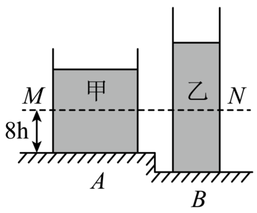

# Physics - 题目 1657

**ID**: 5b6b8b3b39e246bcb71af0f505211ffa
**年级**: Grade 8
**难度**: Medium-Hard
**题型**: Calculation

## 题目
如图所示，薄壁圆柱形容器A、B分别置于高度差为h的两个水平面上，容器均足够高，A中盛有深度为16h的液体甲，B中盛有深度为19h的液体乙。​​​​​​​‌（ρ_{乙}=0.8×10^{3}千克/米^{3}）求：(1)若液体乙的体积为5×10^{3}米^{3}，求液体乙的质量m_{乙}；(2)若在图示水平面MN处两种液体的压强相等。现有二个物体C、D，其密度、体积的关系如下表所示。请选择其中一个，将其放入容器A或B中后（物体均能浸没在液体中），可使液体对容器底部压强增加量Δp_{液}与水平面受到的压强增加量Δp_{地}的比值最大。写出选择的物体和容器并说明理由，求出Δp_{液}与Δp_{地}的最大比值。物体密度×10^{3}千克/米^{3}体积×10^{3}米^{3}）C43D23

## 解答

1. 解：(1)液体乙的质量为
2. m_{乙}=ρ_{乙}V_{乙}=0.8×10^{3}kg/m^{3}×5×10^{-3}m^{3}=4kg
3. (2)水平面MN处两种液体的压强相等，即
4. pM=p_{N}
5. ρ_{甲}ghM=ρ_{乙}gh_{N}
6. 可得
7. ρ_{甲}= $\frac {ρ{{}_{乙}}h{{}_{N}}}{h{{}_{M}}}=\frac {0.8\times 10{^{3}}{\rm{k}}{\rm{g}}{\rm{/}}{\rm{m}}{^{3}}\times \left ({19h-8h-h}\right )}{16h-8h}$ =1×10^{3}kg/m^{3}
8. 液体对容器底部压强增加量Δp_{液}与水平面受到的压强增加量Δp_{地}的比值为
9. $\frac {Δp{{}_{液}}}{Δp{{}_{地}}}=\frac {F{{}_{浮}}}{G{{}_{物}}}=\frac {ρ{{}_{液}}V{{}_{排}}g}{ρ{{}_{物}}V{{}_{物}}g}=\frac {ρ{{}_{液}}}{ρ{{}_{物}}}$
10. ρ_{液}越大，ρ_{物}越小，比值越大，故选择物体D放入容器A中。Δp_{液}与Δp_{地}的最大比值为
11. $\left ({\frac {Δp{{}_{液}}}{Δp{{}_{地}}}}\right ){{}_{\max }}=\frac {ρ{{}_{甲}}}{ρ{{}_{{\rm{D}}}}}=\frac {1\times {\rm{1}}{\rm{0}}{^{{\rm{3}}}}{\rm{k}}{\rm{g}}{\rm{/}}{\rm{m}}{^{{\rm{3}}}}}{2\times {\rm{1}}{\rm{0}}{^{{\rm{3}}}}{\rm{k}}{\rm{g}}{\rm{/}}{\rm{m}}{^{{\rm{3}}}}}$ =0.5
12. 答：(1)液体乙的质量为4kg；
13. (2)Δp_{液}与Δp_{地}的最大比值为0.5。

## 知识点

**中文**:
  - 液体压强的判断与计算

**English**:
  - Determination and Calculation of Liquid Pressure

---
