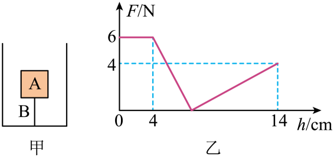

# Physics - 题目 667

**ID**: 61d5cbde4c4647eea48a4f468a1fe88f
**年级**: Grade 8
**难度**: Medium-Hard
**题型**: Calculation

## 题目
如图甲是小何设计的力学装置，他将不吸水的实心正方体A固定在竖直细杆B的上端，竖直细杆B的下端通过力传感器固定器在柱形容器底部，力传感器可以显示出细杆B的下端受到作用力的大小，不计细杆B及连接处的质量和体积。​​​​​​​‌现缓慢向容器中加水，当水深为14 cm时正方体A刚好浸没。力传感器的示数大小F随水深h变化的图像如图乙所示。求：（1）正方体A受到的重力。（2）正方体A刚好浸没时，A下表面受到水的压力。（3）当力传感器显示为2 N时，水对容器底部的压强。

## 解答

1. 解：（1）由图乙可知，当水的深度为0~4cm时，此时A不受浮力，力传感器的示数等于A的重力，即为G_{A}=F=6N
2. （2）由图乙可知，当h_{1}=h_{杆}=4cm，时，物体A的下表面恰好与水面接触，当容器内水的深度h_{2}=14cm时，正方体A刚好浸没，则正方体A的边长为L=h_{浸}=14cm-4cm=10cm=0.1m，
3. A下表面受到的压强为p_{A}=ρ_{水}gh_{浸}=1.0×10^{3}kg/m^{3}×10N/kg×0.1m=1000Pa，A的底面积为S_{A}=L^{2}=（0.1m）^{2}=1×10^{-2}m^{2}^{，}A下表面受到水的压力为F_{A}=p_{A}S_{A}=1000Pa×1×10^{-2}m^{2}=10N
4. （3）①当F_{浮}<G，力传感器的示数为F′=2N时，浮力大小为F_{浮}=G-F′=6N-2N=4N，此时A排开水的体积为 $V{{}_{排}}=\frac {F{{}_{浮}}}{ρ{{}_{水}}g}=\frac {4{\rm{N}}}{1.0\times 10{^{3}}{\rm{k}}{\rm{g}}{\rm{/}}{\rm{m}}{^{3}}\times 10{\rm{N}}{\rm{/}}{\rm{k}}{\rm{g}}}=4\times 10{^{-4}}{\rm{m}}{^{{{3}}}}$ ，则正方体A浸在水中的深度为 $h{{}_{排}}=\frac {V{{}_{排}}}{S{{}_{{\rm{A}}}}}=\frac {4\times 10{^{-4}}{\rm{m}}{^{{{3}}}}}{1\times 10{^{-2}}{\rm{m}}{^{2}}}=0.04{\rm{m}}{\rm{=}}{{4}}{\rm{c}}{\rm{m}}$ ，所以此时容器中水的深度为h=L_{杆}+h_{排}=4cm+4cm=8cm=0.08m，则当力传感器的示数F=2N，容器底部受到水的压强为p=ρ_{水}gh=1.0×10^{3}kg/m^{3}×10N/kg×0.08m=800Pa，②当F_{浮}>G，力传感器的示数为F′=2N时，浮力大小为F_{浮}′=G+F′=6N+2N=8N，此时A排开水的体积为 $V{{}_{排}}\mathrm{′}=\frac {F{{}_{浮}}\mathrm{′}}{ρ{{}_{水}}g}=\frac {8{\rm{N}}}{1.0\times 10{^{3}}{\rm{k}}{\rm{g}}{\rm{/}}{\rm{m}}{^{3}}\times 10{\rm{N}}{\rm{/}}{\rm{k}}{\rm{g}}}=8\times 10{^{-4}}{\rm{m}}{^{{{3}}}}$ ，则正方体A浸在水中的深度为 $h{{}_{排}}\mathrm{′}=\frac {V{{}_{排}}\mathrm{′}}{S{{}_{{\rm{A}}}}}=\frac {8\times 10{^{-4}}{\rm{m}}{^{{{3}}}}}{1\times 10{^{-2}}{\rm{m}}{^{2}}}=0.08{\rm{m}}{\rm{=}}{{8}}{\rm{c}}{\rm{m}}$ ，所以此时容器中水的深度为h′=L_{杆}+h_{排}′=4cm+8cm=12cm=0.12m，则当力传感器的示数F′=2N，容器底部受到水的压强为p′=ρ_{水}gh′=1.0×10^{3}kg/m^{3}×10N/kg×0.12m=1200Pa
5. 答：（1）正方体A受到的重力为6N；
6. （2）正方体A刚好浸没时，A下表面受到水的压力为10N；
7. （3）当力传感器显示为2 N时，水对容器底部的压强为800Pa或1200Pa。

## 知识点

**中文**:
  - 浮力大小的计算
  - 液体压强计算公式的应用
  - 阿基米德原理的应用

**English**:
  - Calculation of Buoyancy
  - Application of Liquid Pressure Formula
  - Applications of Archimedes' Principle

---
