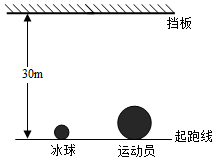

# Physics - 题目 2086

**ID**: 624704fa40484c1e8c0caf0dce9a2431
**年级**: Grade 8
**难度**: Medium-Hard
**题型**: Calculation

## 题目
为提高冰球运动员的能力，教练员经常要求运动员做击球训练和追球训练。​​​​​​​‌在冰面上与起跑线距离30m处设置一个挡板，如图。做击球训练时，运动员从起跑线将冰球往挡板方向水平击出，冰球运动时的速度大小不变，运动方向始终垂直于起跑线和挡板，遇到挡板后立即垂直于挡板反弹回来，反弹时速度不变，教练员帮助计时。某次击球，球从被击出到回到起跑线用时4s。（运动员、冰球视为同点）求：(1)请计算冰球被击出时的速度大小。(2)某次击球，反弹时速度变为原来的一半，球从被击出到回到起跑线用时3s，做追球训练时，冰球被击出的同时，运动员立即垂直于起跑线出发追击小球，已知运动员的速度大小为刚击出的冰球速的 $\frac {1}{3}$  ，且大小不变，请通过计算确定运动员在离挡板多远处能接到球。

## 解答

1. 解：(1)运动员从起跑线将冰球往挡板方向水平击出，冰球运动时的速度大小不变，运动方向始终垂直于起跑线和挡板，遇到挡板后立即垂直于挡板反弹回来，反弹时速度不变，
2. 所以冰球被击出时的速度
3. $v=\frac {2s}{t}=\frac {30{\rm{m}}\times 2}{4{\rm{s}}}=15{\rm{m}}{\rm{/}}{\rm{s}}$
4. (2)设冰球被击出时的速度为v，则遇到挡板反弹时速度 $v\prime =\frac {1}{2}v$ ,所以冰球被击出后运动到挡板的时间
5. $t{{}_{1}}=\frac {s}{v}$
6. 冰球遇到挡板反弹后回到起跑线的时间
7. $t{{}_{2}}=\frac {s}{v\prime }$
8. 因球从被击出到回到起跑线用时3s，所以
9. $t{{}_{1}}+t{{}_{2}}=\frac {s}{v}+\frac {s}{v\prime }=\frac {30{\rm{m}}}{v}+\frac {30{\rm{m}}}{\frac {1}{2}v}=3{\rm{s}}$
10. 解得v＝30m/s，v'＝15m/s，设运动员运动的总时间为t'，则冰球遇到挡板反弹后到运动员接到球的时间为 $t^{′}-t{{}_{1}}$ ， 因冰球和运动员运动的距离之和等于起跑线到挡板距离的2倍，由题意知运动员运动的速度
11. $v^{′′}=\frac {1}{3}v=\frac {1}{3}\times 30{\rm{m}}{\rm{/}}{\rm{s}}{\rm{=}}{\rm{1}}{\rm{0}}{\rm{m}}{\rm{/}}{\rm{s}}$
12. 则有
13. $vt{{}_{1}}+v^{′}\left ({t^{′}-t{{}_{1}}}\right )+v^{′′}t^{′}=2s$
14. 代入数据解得t′=1.8s，运动员接到球的位置到挡板的距离
15. $s^{′}＝s﹣v^{′′}t^{′}=30{\rm{m}}-10{\rm{m}}{\rm{/}}{\rm{s}}\times 1.8{\rm{s}}{\rm{=}}{\rm{1}}{\rm{2}}{\rm{m}}$
16. 答：(1)冰球被击出时的速度为15m/s；
17. (2)运动员在离挡板12m远处能接到球。

## 知识点

**中文**:
  - 速度公式及其应用

**English**:
  - Velocity Formula and Applications

---
