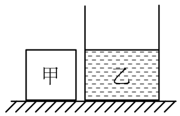

# Physics - 题目 2628

**ID**: 64ddb9c07bb44fb9918218a6035c14e9
**年级**: Grade 8
**难度**: Medium-Hard
**题型**: Calculation

## 题目
如图所示，密度为2 $\times $ 10^{3}千克/米^{3}、边长为0.1米均匀正方体甲和底面积为2 $\times $ 10^{-2}米^{2}的薄壁柱形容器乙放在水平地而上，乙容器足够高，内盛有0.1米深的水。​​​​​​​‌（1）求正方体甲的质量m_{甲}；（2）求水对乙容器底部的压强p_{乙}；（3）在甲的上部水平截去体积为V后，甲对水平地面的压强变为p_{甲}_{′}；将截取部分放入乙容器中，水对乙容器底部的压强变为p_{乙}_{′}，且p_{甲}′=p_{乙}′。试求水平截去体积V的大小。

## 解答

1. 解：（1）由题意可知，正方体甲的体积
2. V_{甲}=a^{3}=(0.1m)^{3}=1×10^{-3}m^{3}
3. 由密度公式 $ρ=\frac {m}{V}$ 可得，正方体的质量
4. m_{甲}=ρ_{甲}V_{甲}=2×10^{3}kg/m^{3}×1×10^{-3}m^{3}=2kg
5. （2）乙容器内盛有0.1米深的水，由公式p=ρgh可得，水对乙容器底部的压强
6. p_{乙}=ρ_{乙}gh_{乙}=1×10^{3}kg/m^{3}×10N/kg×0.1m=1×10^{3}P_{a}
7. （3）在甲的上部水平截去体积为V后，甲物体截取部分的高度为
8. $h{{}_{甲}}^{′}=\frac {V}{S}=\frac {V}{{\left({0.1m}\right)^{2}}}=\frac {V}{0.01m{^{2}}}$
9. 甲物体截取后的高度为
10. $h{{}_{甲}}^{′′}=h{{}_{甲}}-h{{}_{甲}}^{′}=0.1{\rm{m}}{\rm{-}}\frac {V}{0.01{\rm{m}}{^{{^{2}}}}}$
11. 将截取部分放入乙容器中后，乙液体增加的高度为
12. $h{{}_{乙}}^{′}=\frac {V}{S{{}_{乙}}}=\frac {V}{2\times 10{^{-2}}{\rm{m}}{^{2}}}$
13. 乙液体此时的高度为
14. $h{{}_{乙}}^{′′}=h{{}_{乙}}+h{{}_{乙}}^{′}=0.1{\rm{m}}{\rm{+}}\frac {V}{2\times 10{^{-2}}{\rm{m}}{^{2}}}$
15. 由题意可知此时甲、乙压强相等，即
16. p_{甲}′=p_{乙}′
17. ρ_{甲}gh_{甲}′′=ρ乙gh_{乙}′′
18. $2\times 10{^{3}}{\rm{k}}{\rm{g}}{\rm{/}}{\rm{m}}{^{3}}\times \left ({{\rm{0}}{\rm{.}}{\rm{1}}{\rm{m}}{\rm{-}}\frac {V}{0.01{\rm{m}}{^{{^{2}}}}}}\right )g=1\times 10{^{3}}{\rm{k}}{\rm{g}}{\rm{/}}{\rm{m}}{^{3}}\times \left ({0.1{\rm{m}}{\rm{+}}\frac {V}{2\times 10{^{-2}}{\rm{m}}{^{2}}}}\right )g$
19. 解得
20. V=4×10^{-4}m^{3}
21. 答：（1）正方体甲的质量为2kg；
22. （2）水对乙容器底部的压强1×10^{3}P_{a}；
23. （3）水平截去体积V的大小为4×10^{-4}m^{3}。

## 知识点

**中文**:
  - 液体压强的判断与计算

**English**:
  - Determination and Calculation of Liquid Pressure

---
