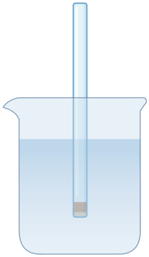

# Physics - 题目 2596

**ID**: 7ca66e5577d744349d8f11de98452c6a
**年级**: Grade 8
**难度**: Medium-Hard
**题型**: Calculation

## 题目
同学们自制简易密度计来粗略测量液体的密度。​​​​​​​‌将粗细均匀的吸管一端密封，在吸管内装上适量的铁砂，吸管总长为16cm，吸管的横截面积为 ${{0}}{{.}}{{2}}{\rm{c}}{\rm{m}}{^{2}}$ 。将该密度计放入水中，待其稳定后，吸管露出水面的长度为10cm，如图所示。水的密度为 $1.0\times {{1}}{{0}}{^{3}}{\rm{k}}{\rm{g}}{\rm{/}}{\rm{m}}{^{3}}{\rm ，\mathit{g}}$ 取10N/kg。请回答下列问题：（1）密度计受到的浮力是多少？（2）若把该密度计放入盐水中，待其漂浮时，吸管露出液面的长度为11cm，盐水的密度是多少？（3）小明认为，该密度计在水和盐水中浸入的深度差 $Δh$ 较小。若想增大 $Δh$ ，应该增加铁砂的质量还是减小吸管的横截面积？请你通过分析进行说明。

## 解答

1. （1）密度计浸入水中的长度h_{水}=L−h_{露}_{1}=16cm−10cm=6cm=0.06m
2. 密度计排开水的体积V_{排}=Sh_{水}=0.2×10^{−4}m^{2}×0.06m=1.2×10^{−6}m^{3}
3. 密度计受到的浮力F_{浮}=ρ_{水}gV_{排}=1.0×10^{3}kg/m^{3}×10N/kg×1.2×10^{−6}m^{3}=0.012N
4. （2）当把密度计放入盐水中，露出液面的长度h_{露}_{2}=11cm，则浸入盐水中的深度h_{盐水}=L−h_{露}_{2}=16cm−11cm=5cm=0.05m
5. 此时密度计排开盐水的体积V_{排盐水}=Sh_{盐水}=0.2×10^{−4}m2×0.05m=1×10^{−6}m^{3}
6. 因为密度计在盐水中也漂浮，所以F_{浮盐水}=F_{浮}=0.012N
7. 再根据阿基米德原理F_{浮盐水}=ρ_{盐水}gV_{排盐水}，可得盐水的密度 $ρ{{}_{盐水}}=\frac {F{{}_{浮盐水}}}{gV{{}_{排盐水}}}=\frac {0.012{\rm{N}}}{10{\rm{N}}/kg\times 1\times 10{^{-6}}{\rm{m}}{^{3}}}=1.2\times 10{^{3}}kg/{\rm{m}}{^{3}}$
8. （3）设密度计的重力为G，在水中浸入深度为h_{水}，在盐水中浸入深度为h_{盐水}。因为密度计在水和盐水中都漂浮，所以F_{浮水}=F_{浮盐水}=G
9. 即ρ_{水}gSh_{水}=ρ_{盐水}gSh_{盐水}=G
10. 则 $h{{}_{水}}=\frac {G}{ρ{{}_{水}}gS}$ ， $h{{}_{盐水}}=\frac {G}{ρ{{}_{盐水}}gS}$
11. 那么  ${\rm{Δ}}h=h{{}_{水}}-h{{}_{盐水}}=\frac {G}{ρ{{}_{水}}gS}-\frac {G}{ρ{{}_{盐水}}gS}=\frac {G}{gS}\left ({\frac {1}{ρ{{}_{水}}}-\frac {1}{ρ{{}_{盐水}}}}\right )$
12. 增加铁砂质量：增加铁砂质量会使密度计重力G增大，由 ${\rm{Δ}}h=\frac {G}{gS}\left ({\frac {1}{ρ{{}_{水}}}-\frac {1}{ρ{{}_{盐水}}}}\right )$ 可知，Δh会增大。
13. 减小吸管横截面积：减小吸管横截面积S，由 ${\rm{Δ}}h=\frac {G}{gS}\left ({\frac {1}{ρ{{}_{水}}}-\frac {1}{ρ{{}_{盐水}}}}\right )$ 可知，Δh也会增大。
14. 综上所述，增加铁砂的质量或减小吸管的横截面积都可以增大Δh。

## 知识点

**中文**:
  - 密度计的原理及应用
  - 阿基米德原理的应用
  - 物体的浮沉条件及其应用

**English**:
  - Principle and Application of Hydrometer
  - Applications of Archimedes' Principle
  - Floating/Sinking Conditions and Applications

---
