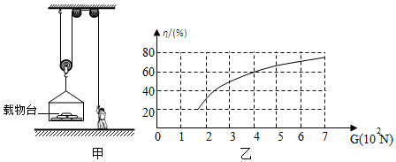

# Physics - 题目 2913

**ID**: 84e09e25a49741b2a910065176344392
**年级**: Grade 8
**难度**: Medium-Hard
**题型**: Calculation

## 题目
佛山某楼盘工地，工人用如图甲所示的滑轮组运送建材上3m高的工作面上，滑轮组的机械效率η随建材重量G变化的图象如图乙，当滑轮组的机械效率为60%时，求：（g取10N/kg）（1）运送的建材重量G_{物}；（2）工人将建材送上工作面所做的有用功W_{有}和总功W_{总}；（3）工人将建材送上工作面需拉动绳子的长度和拉力F的大小；（4）不计摩擦和绳重，则动滑轮和载物台的总重量G_{动}。​​​​​​​‌

## 解答

1. 解：（1）由乙图图象可知，当滑轮组的机械效率为60%时，运送的建材重量G_{物}＝400N。
2. （2）工人将建材送上工作面所做的有用功
3. $W{{}_{有}}＝G{{}_{物}}h＝{\rm{4}}{\rm{0}}{\rm{0}}{\rm{N}}\times {\rm{3}}{\rm{m}}＝{\rm{1}}{\rm{2}}{\rm{0}}{\rm{0}}{\rm{J}}$
4. 由 $η{\rm{=}}\frac {W{{}_{有}}}{W{{}_{总}}}$ 可知，总功
5. $W{{}_{总}}{\rm{=}}\frac {W{{}_{有}}}{η}{\rm{=}}\frac {{\rm{1}}{\rm{2}}{\rm{0}}{\rm{0}}{\rm{J}}}{{\rm{6}}{\rm{0}}{\rm{\%}}}{\rm{=}}{\rm{2}}{\rm{0}}{\rm{0}}{\rm{0}}{\rm{J}}$
6. （3）由图可知n＝2，绳子自由端移动的距离
7. $s＝nh＝{\rm{2}}\times {\rm{3}}{\rm{m}}＝{\rm{6}}{\rm{m}}$
8. 则拉力
9. $F＝\frac {W{{}_{总}}}{s}=\frac {{\rm{2}}{\rm{0}}{\rm{0}}{\rm{0}}{\rm{J}}}{{\rm{6}}{\rm{m}}}\approx {\rm{3}}{\rm{3}}{\rm{3}}{\rm{N}}$
10. （4）因为不计绳重和摩擦时 $F＝\frac {1}{n}\left ({G+G{{}_{动}}}\right )$ ，所以动滑轮和载物台的总重量
11. $G{{}_{动}}＝nF{\rm{-}}G＝{\rm{2}}\times {\rm{3}}{\rm{3}}{\rm{3}}{\rm{N}}{\rm{-}}{\rm{4}}{\rm{0}}{\rm{0}}{\rm{N}}＝{\rm{2}}{\rm{6}}{\rm{6}}{\rm{N}}$
12. 答：（1）运送的建材重量为400N；
13. （2）工人将建材送上工作面所做的有用功为1200J，总功为2000J；
14. （3）工人将建材送上工作面需拉动绳子的长度为6m，拉力F的大小为333N；
15. （4）不计摩擦和绳重，则动滑轮和载物台的总重量为266N。

## 知识点

**中文**:
  - 有用功、额外功和总功的计算
  - 滑轮组及其工作特点
  - 滑轮组绳子拉力的计算

**English**:
  - Calculation of Useful, Extra, and Total Work
  - Pulley Systems and Operating Characteristics
  - Calculating Rope Tension in Pulley Systems

---
