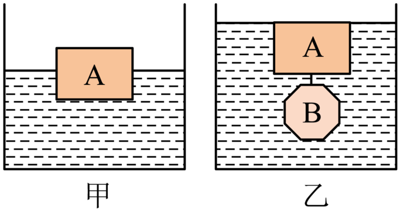

# Physics - 题目 2530

**ID**: 8638dc0497bc4e5d8c60af4dfdc867b7
**年级**: Grade 8
**难度**: Medium-Hard
**题型**: Calculation

## 题目
底面积为100cm^{2}、重为2N的平底圆柱形容器内装有适量的水，放置于水平桌面上．现将体积为500cm^{3}、重为3N的木块A轻放入容器内的水中，静止后水面的高度为10cm，如图甲所示；​​​​​​​‌若将一重为6N的物体B用细绳系于A的下方，使A恰好浸没在水中，如图乙所示(水未溢出)，不计绳重及其体积，求：（1）图甲中木块A静止时浸入水中的体积；（2）物体B的体积；（3）图乙中水对容器底部的压强的改变量．

## 解答

1. （1）因为A漂浮在水中，所以 $F{{}_{浮{\rm{A}}}}=G{{}_{{\rm{A}}}}=3{\rm{N}}$ ， 根据 $F{{}_{浮}}=ρ{{}_{水}}gV{{}_{{{}_{排}}}}$ 得 $V{{}_{排}}=\frac {F{{}_{浮A}}}{ρ{{}_{水}}g}=\frac {{{3}}{\rm{N}}}{{{1}}{{.}}{{0}}\times {{1}}{{0}}{^{{{3}}}}{\rm{k}}{\rm{g}}{\rm{/}}{\rm{m}}{^{{{3}}}}\times {{1}}{{0}}{\rm{N}}{\rm{/}}{\rm{k}}{\rm{g}}}{\rm{=}}{{3}}\times {{1}}{{0}}{^{{{-}}{{4}}}}{\rm{m}}{^{{{3}}}}$ ；
2. （2）图A、B共同悬浮： $F{{}_{浮{\rm{A}}}}+F{{}_{浮{\rm{B}}}}=G{{}_{{\rm{A}}}}+G{{}_{{\rm{B}}}}$ 公式展开： $ρ{{}_{水}}g\left ({V{{}_{{\rm{A}}}}+V{{}_{{\rm{B}}}}}\right )=G{{}_{{\rm{A}}}}+G{{}_{{\rm{B}}}}{\rm ，}$ ， $V{{}_{{\rm{A}}}}+V{{}_{{\rm{B}}}}=\frac {G{{}_{{\rm{A}}}}+G{{}_{{\rm{B}}}}}{ρ{{}_{水}}g}=\frac {3{\rm{N}}+6{\rm{N}}}{1.0\times 10{^{3}}{\rm{k}}{\rm{g}}/{\rm{m}}{^{3}}\times 10{\rm{N}}/{\rm{k}}{\rm{g}}}=9\times 10{^{-4}}{\rm{m}}{^{3}}$ ，
3. 其中 $V{{}_{A}}=500{\rm{c}}{\rm{m}}{^{3}}=5\times 10{^{-4}}{\rm{m}}{^{{{3}}}}$
4. 故 $V{{}_{{\rm{B}}}}=4\times {{1}}0{^{-4}}{\rm{m}}{^{3}}$ ；
5. （3）图乙中 ${\rm{Δ}}V{{}_{排}}=V{{}_{排总}}-V{{}_{排}}={{9}}\times {{1}}{{0}}{^{{{-}}{{4}}}}{\rm{m}}{^{{{3}}}}{{-}}{{3}}\times {{1}}{{0}}{^{{{-}}{{4}}}}{\rm{m}}{^{{{3}}}}{\rm{=}}{{6}}\times {{1}}{{0}}{^{{{-}}{{4}}}}{\rm{m}}{^{{{3}}}}$  ， ${\rm{Δ}}h=\frac {ΔV{{}_{排}}}{S{{}_{容}}}=\frac {{{6}}\times {{1}}{{0}}{^{{{-}}{{4}}}}{\rm{m}}{^{{{3}}}}}{{{1}}{{0}}{{0}}\times {{1}}{{0}}{^{{{-}}{{4}}}}{\rm{m}}{^{{{2}}}}}{\rm{=}}{{0}}{{.}}{{0}}{{6}}{\rm{m}}$ ，
6. 图乙中水对容器底部的压强的改变量为： ${\rm{Δ}}p=ρ{{}_{水}}g{\rm{Δ}}h={{1}}{{.}}{{0}}\times {{1}}{{0}}{^{{{3}}}}{\rm{k}}{\rm{g}}{\rm{/}}{\rm{m}}{^{{{3}}}}\times {{1}}{{0}}{\rm{N}}{\rm{/}}{\rm{k}}{\rm{g}}\times {{0}}{{.}}{{0}}{{6}}{\rm{m}}{\rm{=}}{{6}}{{0}}{{0}}{\rm{P}}{\rm{a}}$
7. 答：（1）图甲中木块A静止时浸入水中的体积是3×10^{-4}m^{3}；
8. （2）物体B的体积是4×10^{-4}m^{3}；
9. （3）图乙中水对容器底部的压强的改变量600Pa．

## 知识点

**中文**:
  - 液体压强的判断与计算
  - 阿基米德原理的应用
  - 物体的浮沉条件及其应用

**English**:
  - Determination and Calculation of Liquid Pressure
  - Applications of Archimedes' Principle
  - Floating/Sinking Conditions and Applications

---
