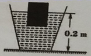

# Physics - 题目 2961

**ID**: 8faa13ddcaba40b6b36702d548d0bad6
**年级**: Grade 8
**难度**: Medium-Hard
**题型**: Calculation

## 题目
如图所示，置于水平桌面上的一个上宽下窄､底面积为0.02m^{2}的薄壁容器内装有一定质量的水，将一个质量为0.3kg、体积为5×10^{-4}m^{3}的物体放入容器内，物体漂浮在水面上，此时容器内水的深度为0.2m，求：(1)物体受到的重力；(2)容器内水对容器底部的压力；(3)要使物体完全浸没在水中，需要在物体上加多大的力。​​​​​​​‌

## 解答

1. (1)物体受到的重力
2. $G=mg=0.3{\rm{k}}{\rm{g}}\times 10{\rm{N}}{\rm{/}}{\rm{k}}{\rm{g}}=3{\rm{N}}$
3. (2)容器内水对容器底部的压强
4. $p=ρ{{}_{水}}gh=1\times 10{^{{\rm{3}}}}{\rm{k}}{\rm{g}}{\rm{/}}{\rm{m}}{^{3}}\times 10{\rm{N}}{\rm{/}}{\rm{k}}{\rm{g}}\times 0.2{\rm{m}}=2\times 10{^{3}}{\rm{P}}{\rm{a}}$
5. 由 $p=\frac {F}{S}$ 得，容器内水对容器底部的压力
6. $F{{}_{压}}=pS=2\times 10{^{3}}{\rm{P}}{\rm{a}}{\rm{\;}}\times 0.02{\rm{m}}{^{2}}=40{\rm{N}}$
7. (3)物体完全浸没到水中时，物体排开水的体积为
8. $V{{}_{排}}=V{{}_{物}}=5\times 10{^{-4{\rm{\;}}}}{\rm{m}}{^{3}}$
9. 受到的浮力
10. $F{{}_{浮}}=G{{}_{排}}=ρ{{}_{水}}gV{{}_{排}}=1\times 10{^{3}}{\rm{k}}{\rm{g}}{\rm{/}}{\rm{m}}{^{3}}\times 10{\rm{N}}{\rm{/}}{\rm{k}}{\rm{g}}\times 5\times 10{^{-4}}{\rm{m}}{^{3}}=5{\rm{N}}$
11. 使物体完全浸没在水中，需要在物体上加的力大小是
12. $F=F{{}_{浮}}-G=5{\rm{N}}-3{\rm{N}}={\rm{2}}{\rm{N}}$
13. 答：(1)物体受到的重力是 $3{\rm{N}}$ ；
14. (2)容器内水对容器底部的压力是 $40{\rm{N}}$ ；
15. (3)要使物体完全浸没在水中，需要在物体上加2N的力。

## 知识点

**中文**:
  - 力的合成与应用
  - 重力公式的应用
  - 压力的概念及其计算
  - 液体压强的大小及其计算
  - 阿基米德原理的应用

**English**:
  - Composition of Forces and Applications
  - Application of Gravity Formula
  - Concept and Calculation of Pressure Force
  - Magnitude and Calculation of Liquid Pressure
  - Applications of Archimedes' Principle

---
