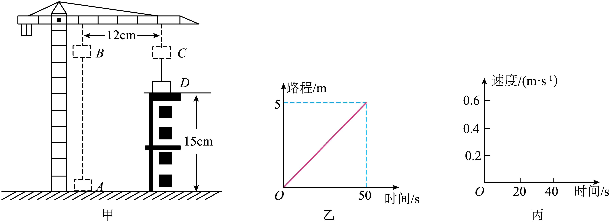

# Physics - 题目 685

**ID**: 910d367a1ffc44d993d4532f935d4aca
**年级**: Grade 8
**难度**: Medium-Hard
**题型**: Calculation

## 题目
如图甲，吊机将建筑材料从地面A处竖直匀速提升40s到达B处，再用58s水平匀速运送到C处，最后竖直放到楼顶D处。​​​​​​​‌建筑材料从C到D共用时50s，路程随时间变化图像如图乙所示。求（1）建筑材料从A到D的平均速度；（2）在图丙中作出建筑材料从A到B的速度随时间变化图像。

## 解答

1. 解：（1）由图乙可知，建筑材料从C到D共用时50s，路程为5m，则由甲可知，AB之间的距离
2. s_{AB}=15m+5m=20m
3. 所以建筑材料从A到D的路程是
4. s_{AD}=s_{AB}+s_{BC}+s_{CD}=20m+12m+5m=37m
5. 建筑材料从A到D的时间
6. t=t_{AB}+t_{BC}+t_{CD}=40s+58s+50s=148s
7. 所以建筑材料从A到D的平均速度
8. $v=\frac {s{{}_{AD}}}{t}=\frac {37{\rm{m}}}{148{\rm{s}}}=0.25{\rm{m}}/{\rm{s}}$
9. （2）AB段的距离为20m，将建筑材料从地面A处竖直匀速提升40s到达B处，故AB段的速度
10. $v^{′}=\frac {s{{}_{AB}}}{t{{}_{AB}}}=\frac {20{\rm{m}}}{40{\rm{s}}}=0.5{\rm{m}}/{\rm{s}}$
11. 建筑材料从A到B的速度随时间变化图像如图所示：
12. 
13. 答：（1）建筑材料从A到D的平均速度是0.25m/s；
14. （2）见解析。

## 知识点

**中文**:
  - 速度的图像问题
  - 速度的综合计算

**English**:
  - Velocity-Time Graphs
  - Comprehensive Velocity Calculations

---
