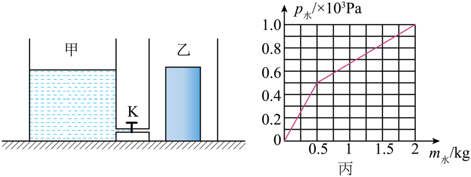

# Physics - 题目 1194

**ID**: 9726aaf5bd2b4f25a9c5fd418456d7c2
**年级**: Grade 8
**难度**: Medium-Hard
**题型**: Calculation

## 题目
如图所示，水平桌面上放置甲、乙两圆柱形容器，两容器底部用细管相连。​​​​​​​‌甲容器底面积为700cm^{2}，水深为20cm；乙容器中放有底面积为200cm^{2}的圆柱形木块。现打开阀门K缓慢向乙容器中注水，水对乙容器底的压强p_{水}与所注水质量m_{水}的关系如图丙所示，木块始终竖直，当注入水的质量等于0.5kg时，木块恰好漂浮，求：（ $ρ{{}_{水}}=1.0\times 10{^{3}}{\rm{k}}{\rm{g}}{\rm{/}}{\rm{m}}{^{3}}，g=10{\rm{N}}{\rm{/}}{\rm{k}}{\rm{g}}$ ）(1)求打开阀门前水对甲容器底部的压强；(2)求木块恰好漂浮时下表面所受的液体压力；(3)将木块换成某种新型材料制成的圆柱体，其形状与木块完全相同，重量为木块的0.6倍，直到水静止时，求水对甲容器底部的压强。

## 解答

1. （1）打开阀门前水对甲容器底部的压强
2. $p{{}_{甲}}=ρ{{}_{水}}gh{{}_{甲}}=1.0\times 10{^{3}}{\rm{k}}{\rm{g}}{\rm{/}}{\rm{m}}{^{{{3}}}}\times 10{\rm{N}}{\rm{/}}{\rm{k}}{\rm{g}}\times 20\times 10{^{﹣}}{^{2}}{\rm{m}}=2000{\rm{P}}{\rm{a}}$
3. （2）当注入水的质量等于0.5kg时，木块恰好漂浮，由图丙可知，水对乙容器底压强
4. $p{{}_{1}}=0.5\times 10{^{3}}{\rm{P}}{\rm{a}}$
5. 则水对木块下表面的压强
6. $p{{}_{木}}=p{{}_{1}}=0.5\times 10{^{3}}{\rm{P}}{\rm{a}}$
7. 木块恰好漂浮时下表面所受的液体压力
8. $F{{}_{木}}=p{{}_{木}}S{{}_{木}}=0.5\times 10{^{3}}{\rm{P}}{\rm{a}}\times 200\times 10{^{﹣4}}{\rm{m}}{^{{{2}}}}=10{\rm{N}}$
9. （3）由于木块恰好漂浮，根据浮力产生的原因和物体的浮沉条件可知此时木块受到的浮力
10. $F{{}_{浮}}=F{{}_{木}}=10{\rm{N}}$
11. 木块浸在水中的体积
12. $V{{}_{排}}=\frac {F{{}_{浮}}}{ρ{{}_{水}}{\rm{g}}}=\frac {10{\rm{N}}}{1.0\times 10{^{3}}{\rm{k}}{\rm{g}}{\rm{/}}{\rm{m}}{^{{{3}}}}\times 10{\rm{N}}{\rm{/}}{\rm{k}}{\rm{g}}}=1\times 10{^{-3}}{\rm{m}}{^{{{3}}}}=1000{\rm{c}}{\rm{m}}{^{{{3}}}}$
13. 乙容器中注入水的深度
14. $h{{}_{水}}=\frac {V{{}_{排}}}{S{{}_{木}}}=\frac {1000{\rm{c}}{\rm{m}}{^{3}}}{200{\rm{c}}{\rm{m}}{^{{{2}}}}}=5{\rm{c}}{\rm{m}}$
15. 当注入水的质量等于0.5kg时，注入水的体积为
16. $V{{}_{水}}=\frac {m{{}_{水}}}{ρ{{}_{水}}}=\frac {0.5{\rm{k}}{\rm{g}}}{1.0\times 10{^{3}}{\rm{k}}{\rm{g}}{\rm{/}}{\rm{m}}{^{{{3}}}}}=5\times 10{^{-4}}{\rm{m}}{^{{{3}}}}=500{\rm{c}}{\rm{m}}{^{{{3}}}}$
17. 乙容器的底面积为
18. $S{{}_{乙}}=\frac {V{{}_{水}}+V{{}_{排}}}{h{{}_{水}}}=\frac {500{\rm{c}}{\rm{m}}{^{3}}+1000{\rm{c}}{\rm{m}}{^{3}}}{5{\rm{c}}{\rm{m}}}=300{\rm{c}}{\rm{m}}{^{{{2}}}}$
19. 甲容器中水的体积为
20. $V{{}_{甲水}}=S{{}_{甲}}h{{}_{甲}}=700{\rm{c}}{\rm{m}}{^{{{2}}}}\times 20{\rm{c}}{\rm{m}}=14000{\rm{c}}{\rm{m}}{^{{{3}}}}$
21. 由于将木块换成某种新型材料制成的圆柱体，其形状与木块完全相同，根据 $ρ=\frac {m}{V}$ 可知，圆柱体的密度是木块的0.6倍，由于木块在水中会漂浮，则圆柱体在水中一定也会漂浮，所以，圆柱体所受重力
22. $G{{}_{柱}}=0.6G{{}_{木}}=0.6F{{}_{木}}=0.6\times 10{\rm{N}}=6{\rm{N}}$
23. 圆柱体在水中漂浮时
24. $F{{}_{浮}}\prime =G{{}_{柱}}=6{\rm{N}}$
25. 圆柱体排开水的体积
26. $V{{}_{排}}^{′}=\frac {F{{}_{浮}}^{′}}{ρ{{}_{水}}{\rm{g}}}=\frac {6{\rm{N}}}{1.0\times 10{^{3}}{\rm{k}}{\rm{g}}{\rm{/}}{\rm{m}}{^{{{3}}}}\times 10{\rm{N}}{\rm{/}}{\rm{k}}{\rm{g}}}=6\times 10{^{-4}}{\rm{m}}{^{{{3}}}}=600{\rm{c}}{\rm{m}}{^{3}}$
27. 打开阀门，甲与乙构成连通器，两侧水面相平，此时甲、乙容器内水的深度
28. $h^{′}=\frac {V{{}_{甲水}}+V{{}_{排}}^{′}\;}{S{{}_{甲}}{{+}}S{{}_{乙}}}=\frac {14000{\rm{c}}{\rm{m}}{^{3}}+600{\rm{c}}{\rm{m}}{^{{{3}}}}}{700{\rm{c}}{\rm{m}}{^{2}}+300{\rm{c}}{\rm{m}}{^{2}}}=14.6{\rm{c}}{\rm{m}}$
29. 甲容器中水对容器底部的压强为
30. $p{{}_{甲}}\prime =ρ{{}_{水}}gh^{′}=1.0\times 10{^{3}}{\rm{k}}{\rm{g}}{\rm{/}}{\rm{m}}{^{{{3}}}}\times 10{\rm{N}}{\rm{/}}{\rm{k}}{\rm{g}}\times 14.6\times 10{^{-2}}{\rm{m}}=1460{\rm{P}}{\rm{a}}$

## 知识点

**中文**:
  - 液体压强计算公式的应用
  - 阿基米德原理的应用
  - 物体的浮沉条件及其应用

**English**:
  - Application of Liquid Pressure Formula
  - Applications of Archimedes' Principle
  - Floating/Sinking Conditions and Applications

---
