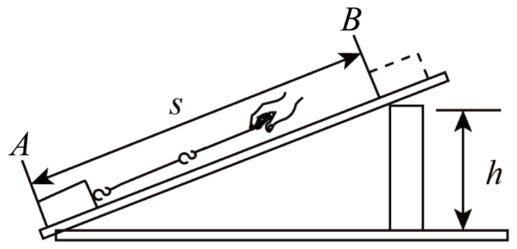

# Physics - 题目 1243

**ID**: 98e0be19ad6d4245b5babee1fbee9ff4
**年级**: Grade 8
**难度**: Medium-Hard
**题型**: Calculation

## 题目
如图所示，沿斜面将一个质量为6kg的物体匀速由A点拉到B点的拉力为40N，升高的高度为0.5m，AB的长度为1m，求：（g取10N/kg）（1）拉力做的有用功；（2）斜面的机械效率；（3）物体受到的摩擦力；（4）请写出一条提高该斜面机械效率的方法。​​​​​​​‌

## 解答

1. 解：（1）拉力做的有用功
2. W_{有}=Gh=mgh=6kg×10N/kg×0.5m=30J
3. （2）拉力F做的功
4. W_{总}=Fs=40N×1m=40J
5. 斜面的机械效率
6. $η=\frac {W{{}_{有}}}{W{{}_{总}}}\times 100\%=\frac {{\rm{3}}{\rm{0}}{\rm{J}}}{{\rm{4}}{\rm{0}}{\rm{J}}}\times 100\%=75\%$
7. （3）额外功
8. W_{额}=W_{总}-W_{有}=40J-30J=10J
9. 物体在斜面上受的摩擦力为
10. f= $\frac {W{{}_{额}}}{s}{\rm{=}}\frac {{\rm{1}}{\rm{0}}{\rm{J}}}{{\rm{1}}{\rm{m}}}{\rm{=}}{\rm{1}}{\rm{0}}{\rm{N}}$
11. （4）提高斜面机械效率的方法：增大斜面的倾角，或者减小斜面与物体之间的摩擦。
12. 答：（1）拉力做的有用功为30J；
13. （2）斜面的机械效率为75%；
14. （3）物体受到的摩擦力为10N。
15. （4）增大斜面的倾角；减小斜面与物体之间的摩擦。

## 知识点

**中文**:
  - 增大或减小机械效率的方法
  - 有用功、额外功和总功的计算
  - 斜面的机械效率及其计算

**English**:
  - Methods to Increase or Decrease Mechanical Efficiency
  - Calculation of Useful, Extra, and Total Work
  - Mechanical Efficiency of Inclined Planes and Calculations

---
