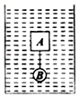

# Physics - 题目 48

**ID**: a11eb840d54c4389bafff7d5615c6b53
**年级**: Grade 8
**难度**: Medium-Hard
**题型**: Calculation

## 题目
如图所示，用细线将正方体A和物体B相连放入水中，两物体静止后恰好悬浮，此时A上表面到水面的高度差为0.​​​​​​​‌12m．已知A的体积为1.0×10^{﹣3}m^{3}，所受重力为8N；B的体积为0.5×10^{﹣3}m^{3}，水的密度ρ=1.0×10^{3}kg/m^{3}，g取10N/kg，求：（1）A上表面所受水的压强；（2）B所受重力大小；（3）细线对B的拉力大小．

## 解答

1. （1）由p=ρgh知道，A上表面所受水的压强是：p=ρ_{水}gh=1×10^{3}kg/m^{3}×10N/kg×0.12m=1200Pa；
2. （2）由阿基米德原理知道，A、B受到的总浮力是：
3. F_{浮}=ρ_{水}gV_{排}=ρ_{水}g（V_{A}+V_{B}）=1×10^{3}kg/m^{3}×10N/kg×（1.0×10^{-3}m^{3}+0.5×10^{-3}m^{3}）=15N；
4. 又因为A、B恰好悬浮，所以F_{浮}=G_{A}+G_{B}，故B的重力是：G_{B}=F_{浮}-G_{A}=15N-8N=7N；
5. （3）由阿基米德原理知道，B受到的浮力是：F_{浮B}=ρ_{水}gV_{排B}=ρ_{水}gV_{B}=1×10^{3}kg/m^{3}×10N/kg×0.5×10^{-3}m^{3}=5N，
6. 所以，细线对B的拉力是：F_{拉}=G_{B}-F_{浮B}=7N-5N=2N．

## 知识点

**中文**:
  - 液体压强计算公式的应用
  - 阿基米德原理的应用
  - 物体的浮沉条件及其应用

**English**:
  - Application of Liquid Pressure Formula
  - Applications of Archimedes' Principle
  - Floating/Sinking Conditions and Applications

---
