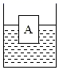

# Physics - 题目 2905

**ID**: af07989c7baf49c3b6cec92ca130aaf7
**年级**: Grade 8
**难度**: Medium-Hard
**题型**: Calculation

## 题目
物体A的体积是2×10^{-3}m^{3}，将它放入水中，露出水面的体积是整个体积的四分之一，物体下表面距液面0.15m，如图所示。​​​​​​​‌（g取10N/kg）求：（1）物体下表面受到的液体压强有多大?（2）物体A所受的浮力是多少？（3）物体A的密度是多大？

## 解答

1. 解：（1）物体下表面距液面0.15m，则物体下表面受到的液体压强
2. p=ρ_{水}gh=1.0×10^{3}kg/m^{3}×10N/kg×0.15m=1.5×10^{3}Pa
3. （2）露出水面的体积是整个体积的四分之一，则
4. V_{排}= $\frac {3}{4}$V_{A}= $\frac {3}{4}$ ×2×10^{-3}m^{3}=1.5×10^{-3}m^{3}
5. 根据阿基米德原理，物体A所受的浮力
6. F_{浮}=ρ_{水}V_{排}g=1.0×10^{3}kg/m^{3}×1.5×10^{-3}m^{3}×10N/kg=15N
7. （3）由于物体漂浮，故G=F_{浮}，由于
8. G=ρ_{物}Vg，F_{浮}=ρ_{水}Vg
9. 则物体A的密度
10. ρ_{物}= $\frac {3}{4}$ρ_{水}= $\frac {3}{4}$ ×1.0×10^{3}kg/m^{3}=0.75×10^{3}kg/m^{3}
11. 答：（1）物体下表面受到的液体压强1.5×10^{3}Pa；
12. （2）物体A所受的浮力是15N；
13. （3）物体A的密度是0.75×10^{3}kg/m^{3}。

## 知识点

**中文**:
  - 液体压强的大小及其计算
  - 阿基米德原理的应用
  - 物体的浮沉条件及其应用

**English**:
  - Magnitude and Calculation of Liquid Pressure
  - Applications of Archimedes' Principle
  - Floating/Sinking Conditions and Applications

---
