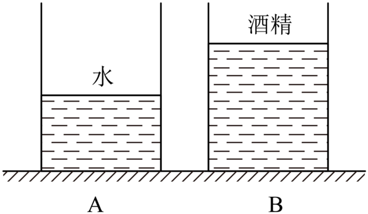

# Physics - 题目 2615

**ID**: b298408ea4c44940a7d3325efa22bf1d
**年级**: Grade 8
**难度**: Medium-Hard
**题型**: Calculation

## 题目
小东的父亲外出时买了两个用铁和铝材料制造的球形艺术品，测得此铁球的质量是1580g，测得铁球体积为240cm^{3}。​​​​​​​‌（ $ρ{{}_{铁}}=7.9\times 10{^{3}}{\rm{k}}{\rm{g}}{\rm{/}}{\rm{m}}{^{{{3}}}}$ ， $ρ{{}_{铝}}=2.79\times 10{^{3}}{\rm{k}}{\rm{g}}{\rm{/}}{\rm{m}}{^{{{3}}}}$ ）（1）请通过计算说明此铁球是实心还是空心的；（2）若是空心的，则空心部分的体积为多少；（3）现将A、B两个完全相同的圆柱形容器放在水平桌面上，分别装有相等质量的水和酒精，容器的底面积为30cm^{2}，A容器内水的深度为20cm。如图所示，将铁球浸没在水中，实心铝球浸没在酒精中，发现两个容器中的液面一样高，且液体均没有溢出，求铝球的质量。（ $ρ{{}_{酒精}}=0.8\times 10{^{3}}{\rm{k}}{\rm{g}}{\rm{/}}{\rm{m}}{^{{{3}}}}$ ）

## 解答

1. （1）若铁球是实心的，则体积应为 $V{{}_{实}}=\frac {m{{}_{铁}}}{ρ{{}_{铁}}}=\frac {1580{\rm{g}}}{7.9{\rm{g}}/{\rm{c}}{\rm{m}}{^{{{3}}}}}=200{\rm{c}}{\rm{m}}{^{{{3}}}}$ ，但铁球的体积为240cm^{3}，因此铁球是空心的。
2. （2）空心部分的体积为 $V{{}_{空}}=V{{}_{铁球}}-V{{}_{铁}}=240{\rm{c}}{\rm{m}}{^{{{3}}}}-200{\rm{c}}{\rm{m}}{^{{{3}}}}=40{\rm{c}}{\rm{m}}{^{{{3}}}}$ 。
3. （3）将铁球浸没在水中，则铁球排开水的体积为 $V{{}_{排}}=V{{}_{铁球}}=240{\rm{c}}{\rm{m}}{^{{{3}}}}$ ，水面上升的高度 $\Delta h{{}_{水}}=\frac {V{{}_{排}}}{S}=\frac {240{\rm{c}}{\rm{m}}{^{{{3}}}}}{30{\rm{c}}{\rm{m}}{^{2}}}=8{\rm{c}}{\rm{m}}$ ，最终水面的高度为 $h{{}_{水}}=20{\rm{c}}{\rm{m}}+8{\rm{c}}{\rm{m}}{\rm{=}}{{2}}{{8}}{\rm{c}}{\rm{m}}$ ，铝球浸没在酒精中，发现两个容器中的液面一样高，且液体均没有溢出，则酒精的高度为 $h{{}_{酒精}}=h{{}_{水}}=28{\rm{c}}{\rm{m}}$ ，酒精质量和水的质量相等，水的质量为 $m{{}_{水}}=ρ{{}_{水}}V{{}_{水}}=1.0{\rm{g}}/{\rm{c}}{\rm{m}}{^{{{3}}}}\times 30{\rm{c}}{\rm{m}}{^{2}}\times 20{\rm{c}}{\rm{m}}=600{\rm{g}}$ ，则酒精的质量 $m{{}_{酒精}}=m{{}_{水}}=600{\rm{g}}$ ，酒精的体积 $V{{}_{酒精}}=\frac {m{{}_{酒精}}}{ρ{{}_{酒精}}}=\frac {600{\rm{g}}}{0.8{\rm{g}}/{\rm{c}}{\rm{m}}{^{{{3}}}}}=750{\rm{c}}{\rm{m}}{^{{{3}}}}$ ，浸入铝球前酒精液面的高度 $h{{}_{酒精}}{^{\prime }}=\frac {V{{}_{酒精}}}{S}=\frac {750{\rm{c}}{\rm{m}}{^{{{3}}}}}{30{\rm{c}}{\rm{m}}{^{2}}}=25{\rm{c}}{\rm{m}}$ ，浸入铝球后酒精液面上升了 $\Delta h{{}_{酒精}}=h{{}_{酒精}}-h{{}_{酒精}}{^{\prime }}=28{\rm{c}}{\rm{m}}-25{\rm{c}}{\rm{m}}=3{\rm{c}}{\rm{m}}$ ，铝球的体积等于铝球排开酒精的体积，即 $V{{}_{铝}}=V{{}_{排酒精}}=S\Delta h{{}_{酒精}}=30{\rm{c}}{\rm{m}}{^{2}}\times 3{\rm{c}}{\rm{m}}=90{\rm{c}}{\rm{m}}{^{{{3}}}}$ ，铝球的质量 $m{{}_{铝}}=ρ{{}_{铝}}V{{}_{铝}}=2.79{\rm{g}}/{\rm{m}}{^{{{3}}}}\times 90{\rm{c}}{\rm{m}}{^{{{3}}}}=251.1{\rm{g}}$ 。

## 知识点

**中文**:
  - 空心、混合物质的密度计算

**English**:
  - Density Calculation of Hollow/Mixed Substances

---
