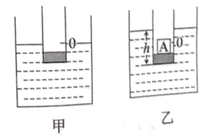

# Physics - 题目 2059

**ID**: c17f7f227e6c4ead8bd16a9ef3ed8a64
**年级**: Grade 8
**难度**: Medium-Hard
**题型**: Calculation

## 题目
小明同学用圆柱形容器制作了一个测量物体质量的装置，它的底部较重，可以竖直漂浮在水面上，总质量为0.21kg，底面积为3×10^{-3}m^{2}，不放物体时，在与水面所对应位置处标为质量的“0”刻度线，如图甲所示。​​​​​​​‌（已知水的密度ρ_{水}=1.0×10^{3}kg/m^{3}，g取10N/kg）请解答下列问题：（1）不放物体时，该装置所受的浮力是多大?（2）如图乙所示，在该装装置中放入一个体积为1.5×10^{-5}m^{3}的物块A，它的底部在水面下的深度h=0.11m，此时，该装置受到的浮力是多大?与水面所对应位置处的刻度线应标为多少g?（3）物块A的密度是多少?

## 解答

1. （1）该装置的重力
2. G_{0}=mg=0.21kg×10N/kg=2.1N
3. 由于装置漂浮，故所受的浮力是
4. F_{浮}=G_{0}=2.1N
5. （2）放入A后，该装置排开水的体积
6. V=Sh=3×10^{-3}m^{2}×0.11m=3.3×10^{-4}m^{3}
7. 所受浮力
8. F_{浮}′=ρ_{水}gV_{排}=1.0×10^{3}kg/m^{3}×10N/kg×3.3×10^{-4}m^{3}=3.3N
9. 由于该装置仍漂浮，故
10. G_{总}=F_{浮}′=3.3N
11. 物块A的重力
12. G_{A}=G_{总}-G_{0}=3.3N-2.1N=1.2N
13. 物块A的质量
14. $m{{}_{A}}=\frac {G{{}_{A}}}{g}=\frac {{\rm{1}}{\rm{.}}{\rm{2}}{\rm{N}}}{10{\rm{N}}{\rm{/}}{\rm{k}}{\rm{g}}}=0.12{\rm{k}}{\rm{g}}{\rm{=}}{\rm{1}}{\rm{2}}{\rm{0}}{\rm{g}}$
15. 所以，与水面所对应位置处的刻度线应标为120g。
16. （3）物块A的密度
17. $ρ{{}_{A}}=\frac {m{{}_{A}}}{V}=\frac {{\rm{0}}{\rm{.}}{\rm{1}}{\rm{2}}{\rm{g}}}{{\rm{1}}{\rm{.}}{\rm{5}}\times {\rm{1}}{\rm{0}}{^{-5}}{\rm{m}}{^{{\rm{3}}}}}={\rm{\;}}8\times 10{^{3}}{\rm{k}}{\rm{g}}{\rm{/}}{\rm{m}}{^{3}}$
18. 答：（1）不放物体时，该装置所受的浮力是2.1N；
19. （2）此时该装置受到的浮力是3.3N，与水面所对应位置处的刻度线应标为120g；
20. （3）物块A的密度是8×10^{3}kg/m^{3}。

## 知识点

**中文**:
  - 密度的简单计算
  - 阿基米德原理的应用
  - 物体的浮沉条件及其应用

**English**:
  - Simple Calculation of Density
  - Applications of Archimedes' Principle
  - Floating/Sinking Conditions and Applications

---
