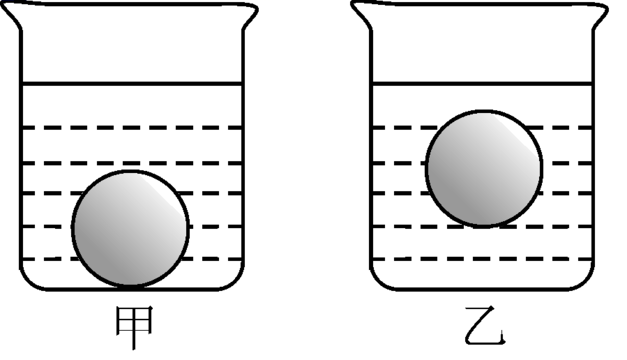

# Physics - 题目 1050

**ID**: ec482cf8bbc54c029eefe0e21666cbf1
**年级**: Grade 8
**难度**: Medium-Hard
**题型**: Calculation

## 题目
某课外兴趣小组在学完浮力后做了“盐水浮鸡蛋”的实验。​​​​​​​‌在水平桌面上放一个底面积为50cm^{2}的圆柱形容器，向容器中倒入一瓶500mL的纯净水，又将一个质量为55g，体积为50cm^{3}的鸡蛋放入其中，如图甲所示，鸡蛋沉底，向水中加盐并搅拌直到鸡蛋恰好悬浮在盐水中，如图乙所示。（ρ_{水}=1.0×10^{3}kg/m^{3}，g=10 N/kg）（1）图甲中鸡蛋受到的浮力是多大？（2）若加入盐的体积忽略不计，图乙中盐水对圆柱形容器底部的压强为多少？

## 解答

1. 解：（1）浸没在水中的鸡蛋排开水的体积
2. V_{排}=V=50 cm^{3}=50×10^{-6}m^{3}
3. 由阿基米德原理得，此时鸡蛋受到的浮力
4. F_{浮}=G_{排水}=ρ_{水}V_{排}g=1.0×10^{3}kg/m^{3}×50×10^{-6}m^{3}×10 N/kg=0.5 N
5. （2）由题可知，鸡蛋在盐水中悬浮，那么
6. ρ_{盐水}=ρ_{鸡蛋}= $\frac {m}{V}=\frac {55{\rm{g}}}{50{\rm{c}}{\rm{m}}{^{3}}}=1.1{\rm{g}}{\rm{/}}{\rm{c}}{\rm{m}}{^{3}}=1.1\times 10{^{3}}{\rm{k}}{\rm{g}}{\rm{/}}{\rm{m}}{^{3}}$
7. 盐水的深度
8. $h=\frac {V{{}_{水}}+V}{S}=\frac {500{\rm cm}{^{3}}+50{\rm cm}{^{3}}}{50{\rm{c}}{\rm{m}}{^{2}}}=11{\rm{c}}{\rm{m}}=0.11{\rm{m}}$
9. 盐水对容器底部的压强
10. p=ρ_{盐水}gh=1.1×10^{3}kg/m^{3}×10 N/kg×0.11 m=1210 Pa
11. 答：（1）图甲中鸡蛋受到的浮力是0.5N；
12. （2）图乙中盐水对圆柱形容器底部的压强为1210Pa。

## 知识点

**中文**:
  - 液体压强的大小及其计算
  - 阿基米德原理的应用
  - 物体的浮沉条件及其应用

**English**:
  - Magnitude and Calculation of Liquid Pressure
  - Applications of Archimedes' Principle
  - Floating/Sinking Conditions and Applications

---
