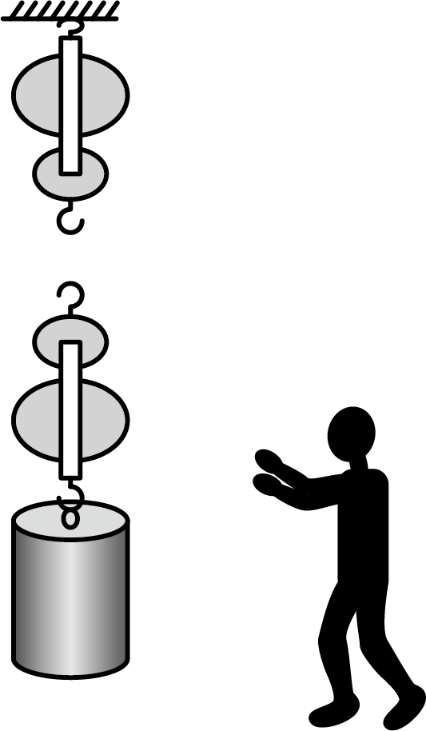

# Physics - 题目 541

**ID**: 186769b05c97443fb1c5c9358870d75f
**年级**: Grade 8
**难度**: Medium-Hard
**题型**: Comprehensive

## 题目
工人师傅利用如图所示的滑轮组匀速提升重物。​​​​​​​‌不计摩擦和绳重，请完成下列问题：（1）请画出滑轮组的绕线图；（2）当重物重为G=160N时，绳中的拉力F=50N，求动滑轮组重是多少?滑轮组的机械效率为多少?（3）如果工人的体重是500N，则该滑轮组的机械效率最大可达到多少?

## 解答

1. 解：（1）由图可知，绳子末端的拉力方向向下，逆着绕绳，发现绳子依次经过大的定滑轮、大动滑轮、小定滑轮、小动滑轮，最后在小定滑轮的挂钩上，可知绳子承担重物的段数n为4。连线方式如图所示
2. 
3. （2）当重物重为G=160N时，绳中的拉力F=50N，根据 $F=\frac {1}{n}\left ({G{{}_{物}}+G{{}_{动}}}\right )$ 可得动滑轮组重
4. $G{{}_{动}}=nF-G{{}_{物}}=4\times 50{\rm{N}}-160{\rm{N}}=40{\rm{N}}$
5. 不计摩擦和绳重，根据
6. $η=\frac {W{{}_{有}}}{W{{}_{总}}}\times 100{\rm{\%}}=\frac {G{{}_{物}}h}{\left ({G{{}_{物}}+G{{}_{动}}}\right )h}\times 100{\rm{\%}}=\frac {G{{}_{物}}}{G{{}_{物}}+G{{}_{动}}}\times 100{\rm{\%}}$
7. 可得滑轮组的机械效率
8. $η=\frac {G{{}_{物}}}{G{{}_{物}}+G{{}_{动}}}\times 100{\rm{\%}}=\frac {160{\rm{N}}}{160{\rm{N}}+40{\rm{N}}}\times 100{\rm{\%}}=80\%$
9. （3）工人的体重是500N，则绳子能承受的最大拉力
10. $F^{′}=500{\rm{N}}$
11. 根据 $F=\frac {1}{n}\left ({G{{}_{物}}+G{{}_{动}}}\right )$ 可得提升的最大物重
12. $G{{}_{物}}{^{\prime }}=nF^{′}-G{{}_{动}}=4\times 500{\rm{N}}-40{\rm{N}}=1960{\rm{N}}$
13. 故由
14. $η=\frac {W{{}_{有}}}{W{{}_{总}}}\times 100{\rm{\%}}=\frac {G{{}_{物}}h}{\left ({G{{}_{物}}+G{{}_{动}}}\right )h}\times 100{\rm{\%}}=\frac {G{{}_{物}}}{G{{}_{物}}+G{{}_{动}}}\times 100{\rm{\%}}$
15. 可知该滑轮组的机械效率最大可达到
16. $η=\frac {G{{}_{物}}{^{\prime }}}{G{{}_{物}}{^{\prime }}+G{{}_{动}}}\times 100{\rm{\%}}=\frac {1960{\rm{N}}}{1960{\rm{N}}+40{\rm{N}}}\times 100{\rm{\%}}=98\%$
17. 答：（1）如解析中图所示；
18. （2）当重物重为G=160N时，绳中的拉力F=50N，动滑轮组重是40N，滑轮组的机械效率为80%；
19. （3）工人的体重是500N，则该滑轮组的机械效率最大可达到98%。

## 知识点

**中文**:
  - 滑轮组及其工作特点
  - 滑轮组的设计与组装
  - 滑轮（组）的机械效率及其计算

**English**:
  - Pulley Systems and Operating Characteristics
  - Design and Assembly of Pulley Systems
  - Mechanical Efficiency of Pulleys and Calculations

---
