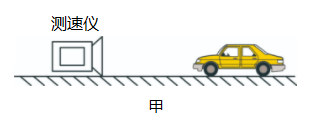
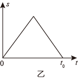
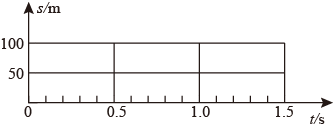

# Physics - 题目 2645

**ID**: 4130f6007c5544a198d1b11cb0bafa94
**年级**: Grade 8
**难度**: Medium-Hard
**题型**: Comprehensive

## 题目
阅读下列短文，回答问题。​​​​​​​‌超声波测速超声波是振动频率高于20000Hz的声波，它具有指向性好、反射能力强、能量集中等特点，可用于测距、测速等。测距是测速的基础，如图甲所示，超声波测速仪向静止的汽车发射超声波信号（简称信号），同时开始计时，信号传播过程中遇到汽车会被反射，测速仪接收到返回的信号就停止计时，根据记录的时间及其与路程、速度的关系，可计算出汽车与测速仪之间的距离，图乙是信号传播过程的s-t图像，s表示信号与测速仪之间的距离，t表示信号传播的时间。则速仪测量汽车速度的原理是：测速仪向运动的汽车先后发射两次信号，根据汽车在两次遇到信号之间所通过的路程及所用的时间，由速度公式可得出汽车的平均速度测速仪在公路上对某跑车进行测速时，向匀速驶来的跑车发射两次信号，两次发射信号的时间间隔是1.0s，第一次发射信号到接收用时0.6s，第二次发射信号到接收用时0.3s。经测速仪测定，该跑车超速，驾驶员将受到交警部门处罚。（超声波速度取340m/s）（1）人耳（选填“能”或“不能”）听到超声波。超声波测速是利用了超声波的指向性好、能量集中、等特点；（2）如图乙所示，若t_{0}=0.4s，则静止的汽车与测速仪之间的距离为m；（3）通过计算，在下图中，大致画出测速仪对该跑车发射的两次信号传播过程的s-t图像（t从第一次发射信号开始计时）。跑车在两次遇到信号之间通过的路程为m，跑车的速度大小为m/s。

## 解答

1. （1）[1]超声波是指频率超过20000Hz的声音，人的听觉范围是20Hz~20000Hz，人耳不能听到超声波。
2. [2]根据文中，超声波具有指向性好、反射能力强、能量集中等特点。
3. （2）[3]如图乙所示，若t_{0}=0.4s，则静止的汽车与测速仪之间的距离为
4. $s=vt=v\frac {t{{}_{0}}}{2}=340{\rm{m}}{\rm{/}}{\rm{s}}\times \frac {0.4{\rm{s}}}{2}=68{\rm{m}}$
5. （3）[4][5]第一次发射信号到接收用时0.6s，跑车遇到信号时，距离测速仪
6. $s{{}_{1}}=v\frac {t{{}_{1}}}{2}=340{\rm{m}}{\rm{/}}{\rm{s}}\times \frac {0.6{\rm{s}}}{2}=102{\rm{m}}$
7. 第二次发射信号到接收用时0.3s，跑车遇到信号时，距离测速仪
8. $s{{}_{2}}=v\frac {t{{}_{2}}}{2}=340{\rm{m}}{\rm{/}}{\rm{s}}\times \frac {0.3{\rm{s}}}{2}=51{\rm{m}}$
9. 跑车在两次遇到信号之间通过的路程为
10. $s=s{{}_{1}}-s{{}_{2}}=102{\rm{m}}-51{\rm{m}}=51{\rm{m}}$
11. 因此测速仪对该跑车发射的两次信号传播过程的s-t图像如图所示：
12. 
13. 跑车遇第一次信号，到测速仪接到信号，时间是接收用时的一半，即0.3s，两次发射信号的时间间隔是1.0s，因此跑车再走0.4s，才发出第二次信号，到跑车与第二次信号相遇，时间要接收用时的一半，即0.15s，因此跑车二次与信号相遇的间隔时间为
14. $t=0.3{\rm{s}}+0.4{\rm{s}}+0.15{\rm{s}}=0.85{\rm{s}}$
15. 跑车速度为
16. $v{{}_{0}}=\frac {s}{t}=\frac {51{\rm{m}}}{0.85{\rm{s}}}=60{\rm{m}}{\rm{/}}{\rm{s}}$

## 知识点

**中文**:
  - 人耳感知声音的过程
  - 超声波的应用
  - 速度公式及其应用

**English**:
  - Process of Sound Perception by the Human Ear
  - Applications of Ultrasound
  - Velocity Formula and Applications

---
