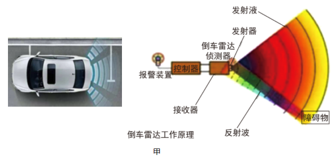
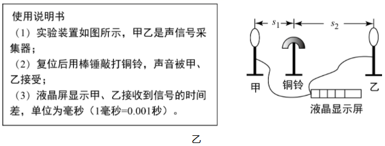

# Physics - 题目 1144

**ID**: 511928aa51964588ae1b8b64ec2729ce
**年级**: Grade 8
**难度**: Medium-Hard
**题型**: Comprehensive

## 题目
阅读短文，回答问题：在现代汽车中一般都安装有倒车雷达，它能实时测量出汽车周围是否存在障碍物，并通过显示屏显示出障碍物的距离．它的工作原理如图甲所示：超声波发射器向外面某一个方向发射出超声波信号，在发射的同时开始进行计时，超声波通过空气进行传播，传播途中遇障碍物就会立即反射回来，超声波接收器在收到反射波的时刻就立即停止计时．超声波在空气中的传播速度约是，计时器通过记录时间 $t$ ，就可以测算出从发射点到障碍物之间的距离 $s$ ，即 $s$ =．但是超声波雷达有一定的局限性，超声波传播速度受天气影响很大，并且当汽车高速行驶时，使用超声波测距无法跟上汽车的车距实时变化，误差较大．另外超声波散射角度大，方向性差，在测量较远的目标时，其回波信号会比较弱，影响测量精度．因此，超声波雷达往往用在短距离测距中．(1)请补充完整文中横线处的填空．(2)中国计划在2020年发射火星探测器对火星进行科学探测，文中的雷达装置(选填“能”或“不能”)安装在火星探测器上使用．(3)如图乙为一超声波测量仪器的使用说明书和实验装置图：①若把铜铃放在甲、乙的中点，则液晶显示屏的示数为；​​​​​​​‌②某同学想验证温度越高，声速越大．把铜铃固定放在甲的左边，然后加热甲、乙之间的空气，则液晶显示屏的示数将．

## 解答

1. (1)超声波在空气中的传播速度v_{声}=340m/s；
2. 超声波从发射点到障碍物的时间：
3. t′= $\frac {t}{2}$
4. 从发射点到障碍物之间的距离：
5. s=vt′=340m/s× $\frac {t}{2}$ =170m/s×t
6. (2)在火星上是真空，而声音不能在真空中传播，所以文中的雷达装置不能安装在火星探测器上使用；
7. (3)①如果铜铃在甲、乙中点，则铜铃与甲的距离和与乙的距离是相等的，且由于声速相同，所以声音从铜铃到达甲、乙的时间相同．故液晶屏的示数为0；
8. ②甲和乙之间的距离一定，由于温度越高，声速越大，所以声音传播到甲和乙的时间都会变小，故时间差也会变小；故B符合题意，ACD不符合题意；
9. ③设声速为v，则声音从铜铃传到甲的时间为：t_{1}= $\frac {s{{}_{{\rm{1}}}}}{v}$ ，声音从铜铃传到乙的时间为：t_{2}= $\frac {s{{}_{2}}}{v}$ ，
10. 由题意可知：
11. t_{2}-t_{1}=2.00×10^{-3}s，
12. $\frac {s{{}_{2}}}{v}$ - $\frac {s{{}_{{\rm{1}}}}}{v}$ =2.00×10^{-3}s，
13. v= $\frac {s{{}_{{\rm{2}}}}-s{{}_{{\rm{1}}}}}{2.00\times 10{^{-3}}{\rm{s}}}{\rm{=}}\frac {0.89{\rm{m}}{\rm{-}}0.2{\rm{m}}}{2.00\times 10{^{{\rm{-}}3}}{\rm{s}}}$ =345m/s．

## 知识点

**中文**:
  - 声速
  - 速度公式及其应用
  - 声音的传播条件

**English**:
  - Speed of Sound
  - Velocity Formula and Applications
  - Conditions for Sound Propagation

---
