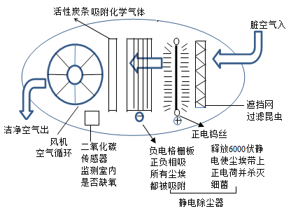

# Physics - 题目 71

**ID**: 5994e5efc1ec439dbf88ad289c84ae38
**年级**: Grade 8
**难度**: Medium-Hard
**题型**: Comprehensive

## 题目
阅读短文，回答问题。​​​​​​​‌空气净化器由于雾霾天气的增多，空气净化器逐渐走入家庭，其工作过程（如图甲）是：脏空气进入净化器时，灰尘被正电钨丝放电而带上正电，流到负电路栅板时，带电灰尘被吸附。此后经过活性炭层时，化学有毒气体被吸附，排出空气的污染物浓度大幅降低，多次循环后变成洁净空气洁净空气量（CADR）是反映其净化能力的性能指标，CADR值越大，其净化效率越高。利用CADR值，可以评估其在运行一定时间后，去除室内空气污染物的效果。按下列公式计算CADR： ${\rm CADR=\frac {2.3V}{t}}$ （V：房间容积；t：空气净化器使房间污染物的浓度下降90%运行的时间），其铭牌如表：型号额定电压额定功率产品净重洁净空气量 （CADR）S89型220V44W10kg138m^{3}/h（1）负电格栅板吸附灰尘的原理是；（2）取出使用一段时间后的活性炭，可以闻到刺激性的气味，说明分子在；（3）为了方便移动这台净化器，在它的下面装上轮子，目的是为了（选填增大或减小）摩擦力；（4）某房间的使用面积为18m²，高度是3m，此空气净化器（能/不能）在1小时内使房间污染物浓度下降90%；（5）空气的密度是1.29kg/m^{3}，请计算出面积为18m^{2}，高度是3m的房间空气的质量。

## 解答

1. （1）[1]由文章可知，负电格栅板吸附灰尘的原理是异种电荷相互吸引。
2. （2）[2]取出使用一段时间后的活性炭，可以闻到刺激性的气味，这是扩散现象，是具有刺激性气味的分子不停息地做无规则运动造成的，故说明分子在永不停息地做无规则运动。
3. （3）[3]为了方便移动这台净化器，在它的下面装上轮子，是通过变滑动为滚动来减小摩擦力。
4. （4）[4]房间的容积为
5. ${\rm V=Sh={\rm{1}}{\rm{8}}{\rm{m}}{^{{\rm{2}}}}{\rm{×}}{\rm{3}}{\rm{m}}{\rm{=}}{\rm{5}}{\rm{4}}{\rm{m}}{^{{\rm{3}}}}}$
6. 使房间污染物浓度下降90%所需的时间为
7. ${\rm t=\frac {2.3V}{CADR}=\frac {{\rm{2}}{\rm{.}}{\rm{3}}{\rm{×}}{\rm{5}}{\rm{4}}{\rm{m}}{^{{\rm{3}}}}}{{\rm{1}}{\rm{3}}{\rm{8}}{\rm{m}}{^{{\rm{3}}}}{\rm{/}}{\rm{h}}}{\rm{=}}{\rm{0}}{\rm{.}}{\rm{9}}{\rm{h}}}$
8. 所以，可以在1小时内使房间污染物浓度下降90%。
9. （5）[5]房间空气的质量为
10. ${\rm m=ρV={\rm{1}}{\rm{.}}{\rm{2}}{\rm{9}}{\rm{k}}{\rm{g}}{\rm{/}}{\rm{m}}{^{{\rm{3}}}}{\rm{×}}{\rm{5}}{\rm{4}}{\rm{m}}{^{{\rm{3}}}}{\rm{=}}{\rm{6}}{\rm{9}}{\rm{.}}{\rm{6}}{\rm{6}}{\rm{k}}{\rm{g}}}$

## 知识点

**中文**:
  - 分子热运动
  - 密度公式的应用
  - 增大或减小摩擦的方法
  - 电荷间的相互作用规律

**English**:
  - Thermal Motion
  - Application of Density Formula
  - Methods to Increase or Decrease Friction
  - Interaction between Charges

---
