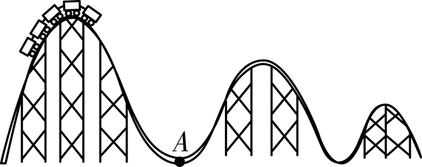

# Physics - 题目 277

**ID**: 5cec16d44c844831b96e26b286e9eb96
**年级**: Grade 8
**难度**: Medium-Hard
**题型**: Comprehensive

## 题目
阅读下列短文，回答问题：过山车当你在游乐场乘过山车奔驰之际，你是否会想到：过山车为什么不需要引擎来推动就能“翻山越岭”呢？过山车在开始旅行时，是靠一个机械装置推上最高点的，但在第一次下行起，就再没有任何装置为它提供动力了。​​​​​​​‌从这时起，带动它沿轨道行驶的唯一“发动机”就是重力势能，过山车的重力势能在处于最高点时达到最大值，当它开始下行时，它的重力势能不断减小，动能不断增大，由于摩擦，损耗了少量的机械能，所以随后的“小山丘”设计的比开始时的“小山丘”低（如图所示），像所有列车一样，过山车也安装了机械制动装置，使它在结束行程或在紧急情况下能够准确地停下来。（1）过山车要通过A点向上运动的过程中，动能，重力势能（均选填“变大”“变小”或“不变”）；（2）后面的“小山丘”设计的比开始时的“小山丘”低，是由于过山车在运动过程中，机械能（选填“变大”“变小”或“不变”）；（3）在过山车旅行的过程中，遇到紧急情况能够准确地停下来，是由于；（4）过山车第一次下行后，是利用能作为“发动机”的动力；（5）小明坐在高速运行的过山车上，感到“天旋地转”，这时他是选择作为参照物的。

## 解答

1. （1）过山车要通过A点向上运动的过程中，速度减小，动能变小；高度增加，重力势能变大。
2. （2）过山车在运动过程中，受到摩擦阻力作用，部分机械能转化为内能，机械能变小。
3. （3）过山车能够停下来的原因是因为有机械制动装置，能够强力使其停止下来。
4. （4）第一次是靠一个机械装置推上最高点的，后面就可以把重力势能转化为动能继续运动，然后动能又转化为重力势能，但因有部分机械能转化为内能，所以后面的高度将有所降低。
5. （5）天、地相对于过山车位置在不断变化，当以过山车为参照物时，天、地是运动的，所以小明感到天旋地转。

## 知识点

**中文**:
  - 动能的变化问题
  - 参照物及其选择
  - 重力势能的变化问题
  - 机械能的变化问题

**English**:
  - Changes in Kinetic Energy
  - Reference Frame and Selection
  - Changes in Gravitational Potential Energy
  - Changes in Mechanical Energy

---
