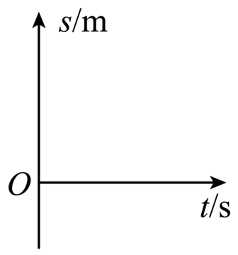

# Physics - 题目 2081

**ID**: 799f3f44949b4c07b2c9c51db1f6b4fb
**年级**: Grade 8
**难度**: Medium-Hard
**题型**: Comprehensive

## 题目
周六早晨，明明爸爸开车带着明明从家里出发去奶奶家，已知明明家到奶奶家路程为 $s$ ，开始汽车以速度 $v{{}_{1}}$ 做匀速直线运动，当车行驶了一半路程时，车子出了点小故障，爸爸修车时间刚好与前半程行驶时间相同，后半程爸爸加快了汽车行驶的速度，此时车以速度 $v{{}_{2}}$ 做匀速直线运动，直到奶奶家，请你帮明明求出从家到奶奶家全程的平均速度，并从图中画出全程的 $s-t$ 图像（标明图像每个点所对应的横纵坐标）。​​​​​​​‌

## 解答

1. 根据 $v=\frac {s}{t}$ 可知，前半程运动的时间 $t{{}_{1}}=\frac {\frac {s}{2}}{v{{}_{1}}}=\frac {s}{2v{{}_{1}}}$
2. 后半程所用时间 $t{{}_{2}}=\frac {\frac {s}{2}}{v{{}_{2}}}=\frac {s}{2v{{}_{2}}}$
3. 中途修车用时 $t{{}_{3}}=t{{}_{1}}$ ，所以全程用时 $t=t{{}_{1}}+t{{}_{2}}+t{{}_{3}}=2t{{}_{1}}+t{{}_{2}}=2\times \frac {s}{2v{{}_{1}}}+\frac {s}{2v{{}_{2}}}=\frac {\left ({2v{{}_{2}}+v{{}_{1}}}\right )s}{2v{{}_{1}}v{{}_{2}}}$
4. 则全程的平均速度 $v=\frac {s}{t}=\frac {s}{\frac {\left ({2v{{}_{2}}+v{{}_{1}}}\right )s}{2v{{}_{1}}v{{}_{2}}}}=\frac {2v{{}_{1}}v{{}_{2}}}{v{{}_{1}}+2v{{}_{2}}}$
5. 因为在 $s-t$ 图像中，倾斜的直线表示物体做匀速直线运动，且倾斜度越大，速度越大，平行于时间轴的直线表示静止，故其图像为：
6. 

## 知识点

**中文**:
  - 平均速度及其计算
  - 速度的图像问题

**English**:
  - Average Velocity and Calculation
  - Velocity-Time Graphs

---
