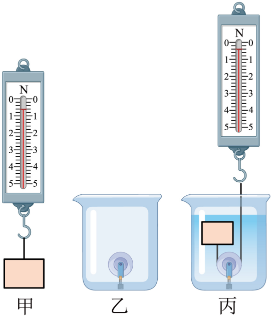

# Physics - 题目 953

**ID**: 8790216666aa4aeaa29de1d29dc3db0d
**年级**: Grade 8
**难度**: Medium-Hard
**题型**: Comprehensive

## 题目
如图所示，小杰同学用弹簧测力计、烧杯、水、吸盘、滑轮、细线来测量木块（不吸水）的密度。​​​​​​​‌(1)如图甲所示，木块所受的重力为N；(2)如图乙所示，将滑轮的轴固定在吸盘的挂钩上，挤出吸盘内部的空气，吸盘在的作用下被紧紧压在烧杯底部。在烧杯中倒入适量的水，水的深度为30cm，用弹簧测力计将木块全部拉入水中，木块下表面距杯底20cm，如图丙所示，此时弹簧测力计示数为0.4N，不计摩擦和绳重。求：①木块下表面受到压的强是多少？（      ）②木块受浮力是多少N？（      ）③木块的密度为多少kg/m^{3}？（      ）

## 解答

1. (1)如图甲所示，弹簧测力计的示数为0.6N，木块所受的重力为0.6N。
2. (2)吸盘内部的空气被挤出，在大气压的作用下吸盘被紧紧压在烧杯底部。
3. (3)水的深度为30cm，木块下表面距杯底20cm，木块下表面的深度为h=30cm-20cm=10cm=0.1m，木块下表面受到压的强是p=ρgh=1.0×10^{3}kg/m^{3}×10N/kg×0.1m=1000Pa，木块受浮力是F_{浮}=G+F_{拉}=0.6N+0.4N=1N，由 $F{{}_{浮}}=ρ{{}_{水}}gV{{}_{排}}$ 可得木块的体积为 $V{{}_{木}}=V{{}_{排}}=\frac {F{{}_{浮}}}{ρ{{}_{水}}g}=\frac {1{\rm{N}}}{1.0\times 10{^{3}}{\rm{k}}{\rm{g}}{\rm{/}}{\rm{m}}{^{3}}\times 10{\rm{N}}{\rm{/}}{\rm{k}}{\rm{g}}}=1\times 10{^{-4}}{\rm{m}}{^{{{3}}}}$ ，木块的密度为 $ρ{{}_{木}}=\frac {m{{}_{木}}}{V{{}_{木}}}=\frac {G{{}_{木}}}{V{{}_{木}}g}=\frac {0.6{\rm{N}}}{1\times 10{^{-4}}{\rm{m}}{^{{{3}}}}\times {{1}}{{0}}{\rm{N}}{\rm{/}}{\rm{k}}{\rm{g}}}=0.6\times {{1}}{{0}}{^{{{3}}}}{\rm{k}}{\rm{g}}{\rm{/}}{\rm{m}}{^{{{3}}}}$

## 知识点

**中文**:
  - 大气压的应用
  - 密度公式的应用
  - 弹簧测力计原理及其使用
  - 液体压强计算公式的应用
  - 阿基米德原理的应用

**English**:
  - Applications of Atmospheric Pressure
  - Application of Density Formula
  - Principle and Use of Spring Dynamometer
  - Application of Liquid Pressure Formula
  - Applications of Archimedes' Principle

---
