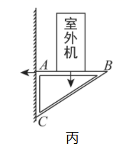

# Physics - 题目 265

**ID**: b6e1c643ca9f4f2fbcf87b53b471eef9
**年级**: Grade 8
**难度**: Medium-Hard
**题型**: Comprehensive

## 题目
请你解释装修时几个常见的现象（1）现象一：屋内开着的门，从窗口进来的一阵风吹过后，如图甲所示，门会自动关上、你用什么物理知识解释：；（2）现象二：当门关上时，有时门会被风吹开，而在门与门概之间垫上几层纸后，如图乙所示，门不会被吹开，主要原因是：；（3）现象三：如图丙所示，用固定在墙上的三角支架ABC放置空调整外机。​​​​​​​‌如果A处螺钉松脱，则支架会绕点倾翻。已知AB长40cm，AC长30cm，室外机的重力为300N，正好处在AB中点处，则A处螺钉的水平拉力为N（支架重力不计）。为了安全，室外机的位置应尽（选填“靠近”或“远离”）墙壁。

## 解答

1. （1）风从门前吹过，门前空气流速大于门后空气流速，门前受到空气压强小于门后受到的空气压强，门后受到空气压力大于门前受到空气压力，所以门关上。
2. （2）在门和门框之间垫几层纸后，通过增大压力的方法增大摩擦力，所以风不能将门吹开。
3. （3）由图知道，用固定在墙上的三角支架ABC放置空调室外机。如果A处螺钉松脱，则支架会绕C点倾翻。
4. C点是支点，空调受到重力而作用在支架上的力是阻力，由杠杆平衡条件知道
5. $F\times AC=G\times \frac {1}{2}AB$
6. A处螺钉的水平拉力为
7. $F=\frac {AB}{2AC}\times G=\frac {40{\rm{c}}{\rm{m}}}{2\times 30{\rm{c}}{\rm{m}}}\times 300{\rm{N}}{\rm{=}}{\rm{2}}{\rm{0}}{\rm{0}}{\rm{N}}$
8. 为了安全，即减小水平拉力F；即在AC、G不变的前提下，要减小AB，故A处螺钉的水平拉力室外机的位置应尽量靠近墙壁。

## 知识点

**中文**:
  - 增大或减小摩擦的方法
  - 流体压强与流速的关系
  - 杠杆平衡条件的应用

**English**:
  - Methods to Increase or Decrease Friction
  - Relationship between Fluid Pressure and Flow Speed
  - Application of Lever Equilibrium Conditions

---
