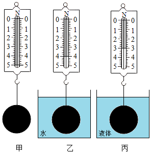

# Physics - 题目 2231

**ID**: b9df55a8fe6d4ef189c55dded6741fb6
**年级**: Grade 8
**难度**: Medium-Hard
**题型**: Comprehensive

## 题目
创新小组自制简易“浸没式液体密度计”，过程为：①将一实心小球悬挂在弹簧测力计下方，示数如图甲所示；②将小球浸没在水中，弹簧测力计示数如图乙所示；③将小球浸没在某未知液体中，弹簧测力计示数如图丙所示；已知ρ_{水}=1×10^{3}kg/m^{3}，g取10N/kg，问：（1）未知液体的密度是g/cm^{3}；（2）该密度计的最大测量值是kg/m^{3}；（3）在测量范围内，某待测液体的密度ρ与弹簧测力计示数F的关系式为ρ=kg/m^{3}（用F和己知数据表示），则该“浸没式液体密度计”的刻度值分布（均匀/不均匀）。​​​​​​​‌

## 解答

1. （1）由图甲、乙可知，小球在水中受到的浮力
2. F_{浮}=5N-4N=1N
3. 由F_{浮}= $ρ$_{水}gV_{排}可得小球排开水的体积
4. V_{排}= $\frac {F{{}_{浮}}}{ρ{{}_{水}}g}$ = $\frac {1{\rm{N}}}{1\times 10{^{3}}{\rm{k}}{\rm{g}}/{\rm{m}}{^{3}}\times 10{\rm{N}}/{\rm{k}}{\rm{g}}}$ =1 $\times $ 10^{-4}m^{3}
5. 由图甲、丙可知，小球在液体中受到的浮力
6. F′_{浮}=5N-3N=2N
7. 小球在液体中排开液体的体积等于排开水的体积，由F_{浮}= $ρ$gV_{排}可得未知液体的密度
8. ρ_{未知}=$\frac {F{{}_{浮}^{；}}}{gV{{}_{排}}}$=$\frac {2{\rm{N}}}{10{\rm{N}}/{\rm{k}}{\rm{g}}\times 1\times 10{^{-4}}{\rm{m}}{^{3}}}$=2 $\times $ 10^{3}kg/m^{3}
9. 即未知液体的密度是2 $\times $ 10^{3}kg/m^{3}。
10. （2）当弹簧测力计示数为0时，即浮力为5N时，密度计达到最大测量值
11. ρ_{最大}= $\frac {F{{}_{浮最大}}}{gV{{}_{球}}}$ = $\frac {5{\rm{N}}}{10{\rm{N}}/{\rm{k}}{\rm{g}}\times 1\times 10{^{-4}}{\rm{m}}{^{3}}}$ =5 $\times $ 10^{3}kg/m^{3}
12. 即该密度计的最大测量值是5 $\times $ 10^{3}kg/m^{3}。
13. （3）在测量范围内
14. ρ_{测}= $\frac {F{{}_{浮}}}{gV{{}_{球}}}$ = $\frac {G-F}{gV{{}_{球}}}$ = $\frac {5{\rm{N}}-F}{10{\rm{N}}/{\rm{k}}{\rm{g}}\times 1\times 10{^{-4}}{\rm{m}}{^{3}}}$ =(5N-F) ${\rm{ }}\times $ 10^{3}kg/m^{3}
15. 故ρ_{测}与F之间是一次函数关系，由于弹簧测力计示数是均匀的，则该“浸没式液体密度计”的刻度值分布是均匀的。

## 知识点

**中文**:
  - 弹簧测力计原理及其使用
  - 阿基米德原理的应用
  - 物体的浮沉条件及其应用

**English**:
  - Principle and Use of Spring Dynamometer
  - Applications of Archimedes' Principle
  - Floating/Sinking Conditions and Applications

---
