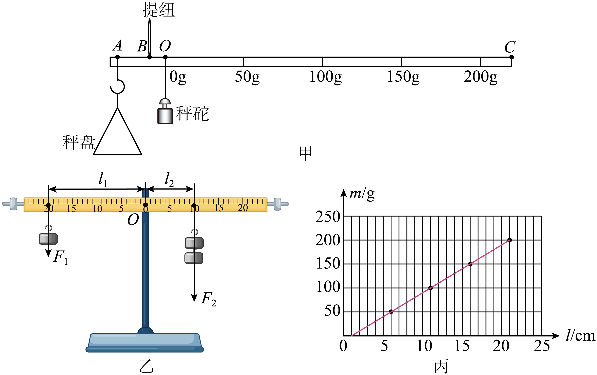

# Physics - 题目 2829

**ID**: e806b4d1dd5b4779848d5d4b5b4919f6
**年级**: Grade 8
**难度**: Medium-Hard
**题型**: Comprehensive

## 题目
在跨学科实践活动中，小海尝试做杆秤：（1）参照图乙可知，杆秤的工作原理是：用图乙中的字母表示）；（2）图甲中（选填“A”“B”或“O”）点相当于杆秤的支点；【制作步骤】①做秤杆：选取一根筷子，在其左端选择两点依次标上“A”“B”；②挂秤盘：取一个小盆，系上细绳，固定在秤杆的“A”处；③系秤纽：在秤杆的“B”处系上细绳；④标零线：用细绳系上一个20g的砝码，作为秤砣，调节秤砣的位置使杆秤平衡。​​​​​​​‌用记号笔在此位置处标“0”；⑤定刻度：在秤盘中逐个添加50g的钩码，手提提纽，使杆秤水平平衡，逐次在秤杆上标记刻度。记录秤砣悬挂位置到提纽B点的长度l及钩码的总质量m，作出 $m-l$ 关系图，如图丙所示。【交流评价】（3）根据图丙，“0”刻度标记在距B点cm处；（4）通过分析杠杆平衡原理得知，杆秤刻度应（选填“是”或“不是”）均匀的；（5）当在秤盘上放置物体称量时，秤砣应从“0”刻度向（选填“左”或“右”）侧移动；（6）如果秤砣磨损，则测量值会比真实值偏（选填“大”或“小”）；（7）要想增大杆秤的测量范围，你可采取的办法是（只写一条即可）。

## 解答

1. （1）杆秤的工作原理是杠杆平衡条件，即 $F{{}_{1}}l{{}_{1}}=F{{}_{2}}l{{}_{2}}$ 。
2. （2）图甲的杆秤使用时绕B点转动，所以B点是支点。
3. （3）根据数学一次函数知识可解得 $m-l$ 关系解析式为 $m=10l-10$ ，将 $m=0{\rm{g}}$ 代入解得 $l=1{\rm{c}}{\rm{m}}$ ，则“0”刻度标记在距B点1cm处。
4. （4）使用杆秤时，根据杠杆平衡条件则有 $m{{}_{物}}g\times AB=m{{}_{秤砣}}g\times l{{}_{秤砣}}$ ，可得 $l{{}_{秤砣}}=\frac {m{{}_{物}}g\times AB}{m{{}_{秤砣}}g}=\frac {AB}{m{{}_{秤砣}}}m{{}_{物}}$
5. 所以秤砣到提纽的距离 $l{{}_{秤砣}}$ 与称量的物体质量 $m{{}_{物}}$ 成正比，所以杆秤刻度应是均匀的。
6. （5）当在秤盘上放置物体称量时，根据 $m{{}_{物}}g\times AB=m{{}_{秤砣}}g\times l{{}_{秤砣}}$ ，要使得杆秤平衡，应将秤砣从“0”刻度向右侧移动。
7. （6）根据 $l{{}_{秤砣}}=\frac {AB}{m{{}_{秤砣}}}m{{}_{物}}$ ，如果秤砣磨损，秤砣的实际质量偏小，则测得的 $l{{}_{秤砣}}$ 偏大，则测量值会比真实值偏大。
8. （7）根据 $l{{}_{秤砣}}=\frac {AB}{m{{}_{秤砣}}}m{{}_{物}}$ ，如果换用质量更大的秤砣，称量同一质量的物体时，测得的 $l{{}_{秤砣}}$ 变小，则杆秤的测量范围增大。

## 知识点

**中文**:
  - 跨学科实践

**English**:
  - Interdisciplinary Practice

---
