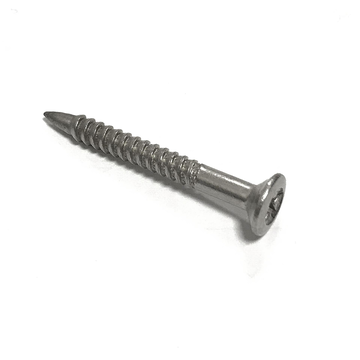
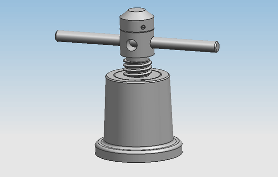
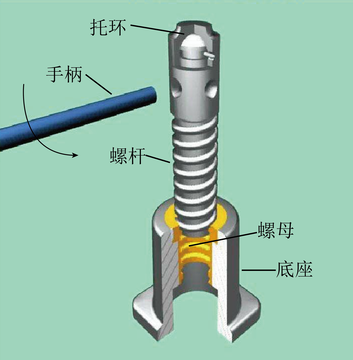
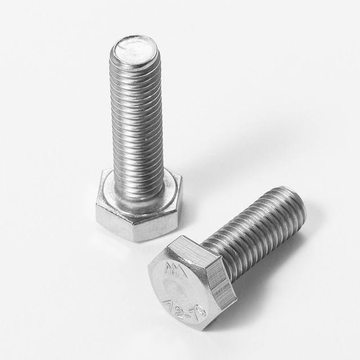

# Physics - 题目 1731

**ID**: eaada60b6c0c4905877403ac97acf748
**年级**: Grade 8
**难度**: Medium-Hard
**题型**: Comprehensive

## 题目
阅读短文，回答问题。​​​​​​​‌螺旋在生产生活中的应用根据斜面可以省力的原理，人们在生活中发明了螺旋状的机械工具，如螺栓、螺钉、螺旋千斤顶等(如图所示)螺旋千斤顶又称机械式千斤顶，是通过人力旋转手柄，使螺杆上升，从而达到将重物举起的目的。普通螺旋千斤顶靠螺纹自锁作用支持重物，最大起重量能达10吨，且构造简单，但传动效率低，返程慢。自降螺旋千斤顶的螺纹无自锁作用，装有制动器，放松制动器，重物即可自行快速下降，缩短返程时间，但这种千斤顶构造较复杂。(1)生活中为了将螺钉旋入木板中，用螺丝刀旋转螺钉时，可以省，但不能省；(2)为了使螺栓使用时更省力，可以在螺纹上涂抹一些润滑油，这是为了减小，盘山公路也可以看成一种螺旋，其目的主要是为了省；(3)使用螺旋千斤顶时，如果人始终垂直于手柄用力为F且作用点离螺杆中心的距离为L，每旋转两圈，螺杆将质量为m的重物上举的高度为h，圆的周长公式为2πr(r为圆的半径) 则螺旋千斤顶的机械效率用字母表示为η=。当升起同一重物时，能提高螺旋千斤顶效率的主要办法是(选填“加润滑油”或“加长手柄”)。

## 解答

1. (1)[1][2]用螺丝刀旋转螺钉时，可以省力，但不能省距离。
2. (2)[3]为了使螺栓使用时更省力，可以在螺纹上涂抹一些润滑油，通过减小接触面的粗糙程度减小摩擦力。
3. [4]盘山公路也可以看成一种螺旋，主要是为了省力。
4. (3)[5]转动一周时，手柄末端通过的距离为
5. s=2πL
6. 转动两周时，垂直给手柄的力为F时所做的功为
7. W=Fs_{总}=F×2s=4FπL
8. 转动两周时重物升高h，克服重物所受重力做的功为
9. W′=mgh
10. 螺旋千斤顶的机械效率
11. $η{\rm{=}}\frac {W^{′}}{W}=\frac {mgh}{4FπL}$
12. [6]当升起同一重物时，克服重物所受重力做的功不变，加润滑油，垂直给手柄的力F减小，由 $η{\rm{=}}\frac {mgh}{4FπL}$ 可知千斤顶效率增大，加长手柄，F做的功较大，效率减小。

## 知识点

**中文**:
  - 其他机械的机械效率及其计算
  - 增大或减小摩擦的方法
  - 功的计算和估算
  - 斜面与轮轴

**English**:
  - Mechanical Efficiency of Other Machines
  - Methods to Increase or Decrease Friction
  - Calculation and Estimation of Work
  - Inclined Plane and Wheel & Axle

---
