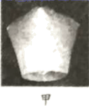
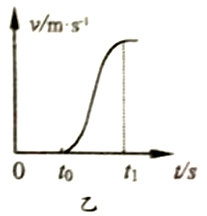

# Physics - 题目 2426

**ID**: ec8ad5cefceb4d1190bfe6f9a2549a45
**年级**: Grade 8
**难度**: Medium-Hard
**题型**: Comprehensive

## 题目
阅读短文，回答问题孔明灯孔明灯俗称许愿灯，又称祈天灯，是一种古老的汉族手工艺品。​​​​​​​‌孔明灯的结构可分为主体与支架两部分，一般的孔明灯是用竹片扎成圆桶形，外面以薄红纸密密包围好，开口朝下，孔明灯可大可小，可圆形也可长方形。在灯笼的下面固定一个小碟，在碟内放入燃料，点燃燃料，孔明灯内部空气受热膨胀，部分气体流出，随着温度的升高，孔明灯内部的空气密度不断减小，数量关系加下表所示，当孔明灯内的空气被加热到一定温度时，就能腾空而起。灯笼受到的空气浮力可以用阿基米德原理计算，即F_{浮}=ρ_{空气}Vg（g取10N/kg）。温度为20℃时，空气密度为1.2kg/m^{3}（忽略孔明灯升空过程中外界空气密度的变化），从点燃到升空，整个过程中孔明灯运动速度和时间的关系如图乙所示。t/℃90100110120130ρ（kg/m^{3}）0.970.940.910.880.85(1)为了更容易升空，制作孔明灯最好选用小的材料；(2)在t_{0}~t_{1}这段时间内，孔明灯处于状态（加速/减速/静止）；(3)下列事例中物体上浮过程和孔明灯升空原理相同的是（选填数字序号）；①向盐水中加水，使水中的鸡蛋上浮      ②卸载货物后船体上浮；(4)根据表中数据，此过程中孔明灯内部空气密度随温度变化关系的图像正确的是；

## 解答

1. (1)[1]孔明灯在空中受到竖直向上的浮力、竖直向下的重力作用，为了更容易升空，制作孔明灯最好选用密度小的材料，降低自重。
2. (2)[2]在t_{0}~t_{1}这段时间内，孔明灯的上升速度随时间不断增大，故处于加速状态。
3. (3)[3]随着温度的升高，孔明灯内部的空气密度不断减小，则其自重也不断减小，与②卸载货物后船体上浮的原理相同。
4. (4)[4]根据表中空气密度和温度的对应关系，在110~120℃之间，温度升高10℃，空气密度减小0.03kg/m^{3}，此过程中孔明灯内部空气密度随温度升高线性减小，故D符合题意。
5. (5)[5]当孔明灯浮起时，说明受到的空气浮力刚好等于灯的重力与灯内热空气重力之和，即
6. $F{{}_{浮}}=ρ{{}_{空气}}gV$
7. $F{{}_{浮}}=G{{}_{灯}}+G{{}_{空气}}=m{{}_{灯}}g+ρ{{}_{热}}gV$
8. 则热空气密度为
9. $ρ{{}_{热}}=\frac {ρ{{}_{空气}}gV-m{{}_{灯}}g}{gV}=ρ{{}_{空气}}-\frac {m{{}_{灯}}}{V}=1.2{\rm{k}}{\rm{g}}{\rm{/}}{\rm{m}}{^{{\rm{3}}}}-\frac {5.2\times 10{^{-3}}{\rm{k}}{\rm{g}}}{0.02{\rm{m}}{^{{\rm{3}}}}}=0.94{\rm{k}}{\rm{g}}{\rm{/}}{\rm{m}}{^{{\rm{3}}}}$
10. 由表中数据可知，灯内空气的温度至少要达到100℃。

## 知识点

**中文**:
  - 密度的应用与物质鉴别
  - 阿基米德原理的应用
  - 物体的浮沉条件及其应用

**English**:
  - Applications of Density and Material Identification
  - Applications of Archimedes' Principle
  - Floating/Sinking Conditions and Applications

---
