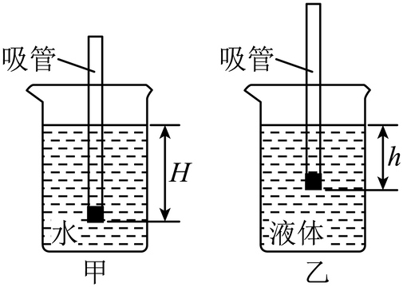

# Physics - 题目 859

**ID**: faa88782640d4383893397a7d103a719
**年级**: Grade 8
**难度**: Medium-Hard
**题型**: Comprehensive

## 题目
跨学科实践：制作吸管密度计。​​​​​​​‌（1）如图甲所示，取一根塑料吸管，下端塞入适量配重的铜丝，在吸管底部用蜡将其恰好密封，使吸管竖直在水中，静止时在吸管上标记水面的位置，测出该位置到吸管下端的距离为H。再将吸管放在其他密度为 $ρ{{}_{液}}$ 的液体中，静止时如图乙所示，测出吸管浸入液体中的深度为h。液体密度 ${ρ{{}_{液}}}/{\left ({{\rm{g}}\cdot {\rm{c}}{\rm{m}}{^{-3}}}\right )}$0.80.91.01.1A浸入深度h/cm7.506.676.005.454.00（2）图甲中吸管受到的浮力大小（选填“大于”“大小”或“等于”）图乙中吸管受到的浮力大小；由 $ρ{{}_{水}}$ 、H、h可以推导出液体的密度表达式为 $ρ{{}_{液}}=$。（3）表格中未求出的数据A应为，由表格数据可以得出，当吸管浸入液体的深度h越小，则液体密度越。在吸管上标出相应刻度即可制成吸管密度计，该密度计的刻度特点是（写出一点即可）。

## 解答

1. （1）密度计竖直漂浮在水中，使密度计受到的重力等于浮力的大小。
2. （2）图甲与图乙中为同一根密度计漂浮在不同液体中，密度计的重力相等，因此图甲中吸管受到的浮力大小等于图乙中吸管受到的浮力大小。
3. 设吸管密度计的底面积为S，由阿基米德原理和浮力相等可知 $ρ{{}_{水}}gSH{\rm{=}}ρ{{}_{液}}gSh$
4. 即 $ρ{{}_{水}}H{\rm{=}}ρ{{}_{液}}h$
5. 解得 $ρ{{}_{液}}=\frac {H}{h}ρ{{}_{水}}$
6. （3）由表格信息可知，密度计静止在水中时，H=6cm；当密度计浸入深度为4cm时，此时液体的密度为  $ρ{{}_{液{\rm{A}}}}=\frac {H}{h{{}_{{\rm{A}}}}}ρ{{}_{水}}=\frac {6{\rm{c}}{\rm{m}}}{4{\rm{c}}{\rm{m}}}\times 1{\rm{g}}/{\rm{c}}{\rm{m}}{^{3}}=1.5{\rm{g}}/{\rm{c}}{\rm{m}}{^{3}}$
7. 表格中未求出的数据A应为 $1.5$ 。
8. 由数据可知，深度从左往右逐渐减小，液体密度从左往右逐渐增大，因此当吸管浸入液体的深度h越小，则液体密度越大。
9. 液体密度越大，吸管浸入液体的深度h越小，对应的刻度越往下，因此该密度计的刻度特点是由上至下示数变大。

## 知识点

**中文**:
  - 密度计的原理及应用

**English**:
  - Principle and Application of Hydrometer

---
