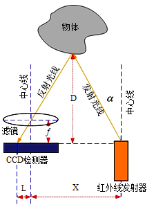

# Physics - 题目 102

**ID**: fc9a15c5ff9946b8b9e63de0e263c97e
**年级**: Grade 8
**难度**: Medium-Hard
**题型**: Comprehensive

## 题目
阅读短文，回答问题：扫地机器人的“眼睛”扫地机器人能自动避开障碍物，像是长了眼睛，它的“眼睛”是什么呢？目前市面上大部分机型使用的是红外探测器。​​​​​​​‌红外探测器测距的原理如图所示，红外发射器以一定的角度发射红外光束，光束遇到物体被反射，再通过有滤光作用的凸透镜（又叫滤镜）后照射到CCD检测器上的某一位置，该位置不在透镜的主光轴（中心线）上，偏离的距离叫偏移值L。根据几何关系可知：物体离传感器越远，L就越小。在知道了偏移值L、两中心线间距X以及滤镜的焦距f后，可以计算得到距离D，也就知道物体有多远了。CCD检测器能将测得的光信号转化为电信号，电信号的大小叫做探测器的输出值，输出值与偏移值L成正比，L增大2倍，输出值也增大2倍，当然有例外，当D很小时，L值较大，光点可能超出探测器的探测范围，即L超过某一值时，输出值会随着L的增大而快速变小，直至变为零；当D很大时，L值又会很小，这时检测器能否分辨得出这个很小的L值成为关键，也就是说CCD的分辨率决定能不能获得足够精确的L值，要检测越远的物体，CCD的分辨率要求就越高，所以通常的探测器只能在一定的范围内有效测量距离D。红外探测器在使用中有两个性能指标：深色物体检出率和环境光抗干扰能力，因为深色物体会吸收部分光能量，而环境光可能对测量产生干扰，这些是红外传感器的研发方向之一。（1）红外传感器发射红外光束，遇到物体时，光束会发生；而滤镜是（阻挡/允许）红外线通过。（2）若某品牌红外探测器：甲探测范围10cm--80cm，乙探测范围20cm--150cm，则（甲/乙）的CCD检测器分辨率较高。（3）下列关于红外探测器的说法，正确的是

## 解答

1. (1)[1][2]根据短文知道，红外传感器发射红外光束，遇到物体时，光束会发生发射；而滤镜是允许红外线通过；
2. (2)[3]根据短文知道，“要检测越远的物体，CCD的分辨率要求就越高，”由于乙的探测范围大于甲的探测范围，所以，乙的CCD检测器分辨率较高；
3. (3)[4]由于红外探测器在使用中有两个性能指标是：深色物体检出率和环境光抗干扰能力，故C符合题意；
4. (4)[5]根据短文知道，偏离的距离叫偏移值L，物体离传感器越远，L就越小；又因为输出值与偏移值L成正比，所以，输出值与物体离传感器成反比，故C符合题意；
5. (5)[6]因为圆盘的直径是30cm，所以，沿3.3m的宽边从一侧走到另一侧通过的距离是：
6. s=3.3m-0.3m=3m，
7. 由 $v=\frac {s}{t}$ 知道，从一侧走到另一侧需要的时间是：
8. $t=\frac {s}{v}=\frac {3{\rm{m}}}{3{\rm{m}}{\rm{/}}{\rm{m}}{\rm{i}}{\rm{n}}}=1{\rm \min }$ ；
9. [7]由于空房间长4.5m，共沿3.3m的宽边行走的次数是：
10. $n=\frac {4.5{\rm{m}}}{0.3{\rm{m}}}=15$ (次)，
11. 沿3.3m的宽边行走的总时间是：
12. $t{{}_{1}}=15t=15\times 1{\rm \min }=15{\rm \min }$
13. 每次由沿3.3m的宽边拐到沿4.5m的长边所用的时间是：
14. $t{{}_{2}}=\frac {4.5{\rm{m}}-0.3{\rm{m}}}{3{\rm{m}}{\rm{/}}{\rm{m}}{\rm{i}}{\rm{n}}}=\frac {4.2{\rm{m}}}{3{\rm{m}}{\rm{/}}{\rm{m}}{\rm{i}}{\rm{n}}}=1.4{\rm \min }$
15. 故要将整个空房间清扫一遍至少需要的时间是：
16. $t{{}_{1}}+t{{}_{2}}=15{\rm \min }+1.4{\rm \min }=16.4{\rm \min }$ 。

## 知识点

**中文**:
  - 红外线的特点及应用
  - 速度公式及其应用

**English**:
  - Characteristics and Applications of Infrared
  - Velocity Formula and Applications

---
