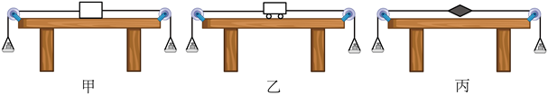

# Physics - 题目 1521

**ID**: 00bc5577b9744274bef7da689d3b74ad
**年级**: Grade 8
**难度**: Medium-Hard
**题型**: Experiment

## 题目
课后服务活动中，物理兴趣小组的同学们进行了“二力平衡条件”的探究。​​​​​​​‌（1）实验过程中小王发现两托盘中的砝码质量相差较多，但物体却能保持静止，所以他得出结论是：互为平衡的两个力大小不相等。得到这一结论是因为他选择了（选填“甲”或“乙”）组器材做的实验；（2）小王把小车转过一个角度，然后松手，观察小车能否恢复到原来的位置，他的这一操作是为了验证“两个力必须才能平衡”这一条件；（3）同组小李提出将装置中的物体换成小卡片，如图丙，这样不但能减小对实验产生的影响，还具有更适合探究的优点（填字母）。

## 解答

1. （2）[2]把小车转过一个角度，两个力的大小与方向都没有变，但不在同一直线上了，根据控制变量法，松手后观察小车能否恢复到原来的位置，是为了验证两个力必须在同一直线上才能平衡。
2. （3）[3]将装置中的物体换成小卡片，与桌面的摩擦力带来的影响可以进行一步减小。
3. [4]A．方向相同的两个力能否平衡乙丙均可以通过两边钩码的拉力的方向调整到同一边来探究，故A不符合题意；
4. B．不在同一条直线上的两个力能否平衡可以通过转一个角度来探究，乙丙均可以方便的实现，故B不符合题意；
5. C．大小不相等的两个力能否平衡可以通过改变两边的钩码的个数来实现，乙丙两方案都能方便的操作，故C不符合题意；
6. D．不在同一物体上的两个力能否平衡丙可以用剪发把纸片中间剪开，乙没办法实现，故D符合题意。
7. 故选D。

## 知识点

**中文**:
  - 二力平衡条件的探究实验

**English**:
  - Experiment: Conditions for Two-Force Equilibrium

---
