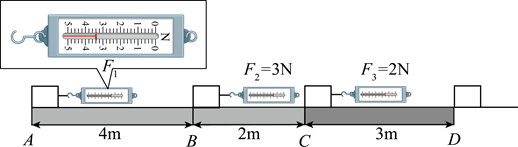

# Physics - 题目 1309

**ID**: 0576cf9878c54ae5af39e93a475a05fd
**年级**: Grade 8
**难度**: Medium-Hard
**题型**: Experiment

## 题目
在“探究影响滑动摩擦力大小因素”的实验中，实验装置如图所示。​​​​​​​‌选取三个相同的木块分别放在不同的接触面上，其中甲、乙两图的接触面是相同的木板，丙图的接触面是棉布。（1）实验中用弹簧测力计水平拉着木块沿水平方向做运动，根据条件可知，木块所受摩擦力的大小等于弹簧测力计的示数；（2）由甲、乙两图可以探究滑动摩擦力大小与的关系；（3）若乙图中的木块在运动过程中受到的拉力突然变大，滑动摩擦力将（选填“不变”、“变大”或“变小”）；（4）如图，AD为水平路面，其中AC段路面相同。同一物体在水平拉力作用下沿直线运动，其中BD段匀速，AB段测力计示数F_{1}=N，AB段物体所受滑动摩擦力f_{1}=N；BC段F_{2}的功率为P_{2}，CD段F_{3}的功率为P_{3}，则P_{2}P_{3}（选填“>”“=”“<”）。

## 解答

1. （1）[1][2]用弹簧测力计水平拉着木块沿水平方向做匀速直线运动，木块处于平衡状态，根据二力平衡条件可知，木块所受摩擦力的大小等于弹簧测力计的示数。
2. （2）[3]甲、乙两图的接触面是相同的木板，压力大小不同，所以探究的是滑动摩擦力大小与压力大小的关系。
3. （3）[4]滑动摩擦力大小只受接触面粗糙程度和压力大小影响，所以木块在运动过程中受到的拉力突然变大，滑动摩擦力大小也不变。
4. （4）[5]由图中弹簧测力计刻度可知，分度值为0.2N，由指针指示位置可读出示数为3.4N。
5. [6]由于BD段才匀速运动，摩擦力等于拉力为3N，且AC段路面相同，所以AB段物体所受所以滑动摩擦力为3N。
6. [7]由于BD段匀速运动，速度相同，由图可知F_{2}大于F_{3}，由P=Fv可得，P_{2}大于P_{3}。

## 知识点

**中文**:
  - 影响滑动摩擦力大小因素的探究实验

**English**:
  - Experiment: Factors Affecting Sliding Friction

---
