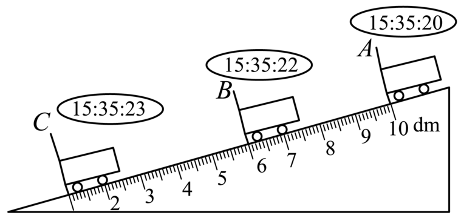
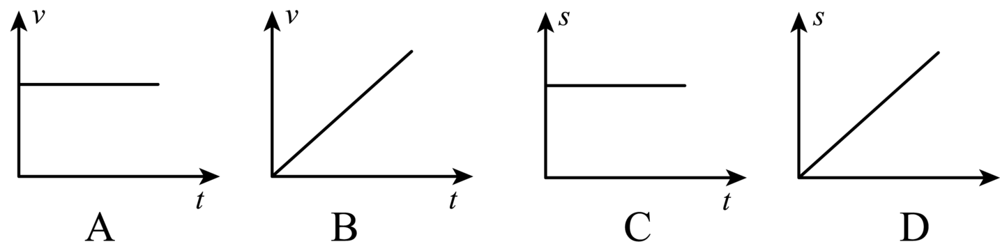

# Physics - 题目 2401

**ID**: 06a93f8af80f4b818c5ceec06a0b67a3
**年级**: Grade 8
**难度**: Medium-Hard
**题型**: Experiment

## 题目
小明在“测量小车的平均速度”实验中，使小车从带刻度尺的斜面上由静止下滑，如图所示。​​​​​​​‌（1）该实验的原理是；（2）AB段距离s_{AB}＝cm，小车在AC段平均速度v_{AC}＝m/s；（3）下列图象中能正确反映小车在斜面上运动情况的是；（4）实验过程中，由于小车运动时间较短，不便于计时，可以通过使斜面的坡度变（选填“陡”或“缓”）的方式，改变小车的运动时间，达到便于测量时间的目的。（5）实验前必须学会熟练使用电子表，如果让小车过了A点后才开始计时，则会使所测AC段的平均速度偏（选填“大”或“小”）；（6）小明进一步实验测得小车在斜面上运动时，前半程平均速度为v_{1}，后半程平均速度为v_{2}，则小车全程平均速度v＝（用字母v_{1}和v_{2}表示）。

## 解答

1. （1）[1]测量平均速度的实验原理是 $v=\frac {s}{t}$ 。
2. （2）[2][3]由图可知AB段的距离为
3. s_{AB}＝10.00dm−6.00dm＝4.00dm＝40.0cm
4. AC段的路程为
5. s_{AC}＝10.00dm−1.00dm＝9.00dm＝0.9m
6. AC段所用的时间为
7. t_{AC}＝15:35:23−15:35:20＝3s
8. 则AC段的平均速度为
9. $v{{}_{AC}}＝\frac {s{{}_{AC}}}{t{{}_{AC}}}=\frac {0.9{\rm{m}}}{3{\rm{s}}}＝0.3{\rm{m}}/{\rm{s}}$
10. （3）[4]由图可知小车从斜面顶端运动到斜面底端的过程中速度越来越快。
11. A．由图可知，随时间增加，速度保持不变，是匀速直线运动，故A不符合题意；
12. B．由图可知，随时间增加，速度也均匀增加，是加速直线运动，故B符合题意；
13. C．由图可知，随时间增加，路程无变化，说明是处于静止状态，故C不符合题意；
14. D．由图可知，在s−t图象中是倾斜直线，说明物体做匀速直线运动，故D不符合题意。
15. 故选B。
16. （4）[5] 斜面的坡度越大，小车在斜面上滑下的速度越大，在斜面上运动的时间越短，不方便测量时间，因此为了方便计时，应调整斜面使坡度较缓。
17. （5）[6] 如果小车过了A点才开始计时，所测量的时间会偏小，而AC段路程一定，由 $v=\frac {s}{t}$ 可知，测得AC段的平均速度会偏大。
18. （6）[7]根据速度公式 $v=\frac {s}{t}$ 可知，小车全程的平均速度等于走的总路程除以全程所用的总时间，上半段所用的时间为
19. $t{{}_{上}}=\frac {\frac {s{{}_{总}}}{2}}{v{{}_{1}}}=\frac {s{{}_{总}}}{2v{{}_{1}}}$
20. 下半段所用的时间为
21. $t{{}_{下}}=\frac {\frac {s{{}_{总}}}{2}}{v{{}_{2}}}=\frac {s{{}_{总}}}{2v{{}_{2}}}$
22. 全程平均速度为
23. $v{{}_{平均}}=\frac {s{{}_{总}}}{t{{}_{上}}+t{{}_{下}}}=\frac {s{{}_{总}}}{\frac {s{{}_{总}}}{2v{{}_{1}}}+\frac {s{{}_{总}}}{2v{{}_{2}}}}=\frac {2v{{}_{1}}v{{}_{2}}}{v{{}_{1}}+v{{}_{2}}}$

## 知识点

**中文**:
  - 测量物体运动的平均速度

**English**:
  - Measuring Average Velocity of an Object

---
