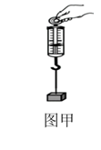
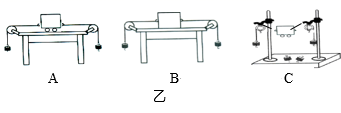
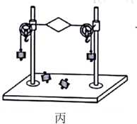
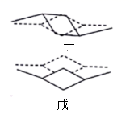

# Physics - 题目 108

**ID**: 0e2960203dd6463ab60ba32617d84632
**年级**: Grade 8
**难度**: Medium-Hard
**题型**: Experiment

## 题目
在“探究二力平衡的条件”活动中。​​​​​​​‌(1)如果物体只受到两个力的作用，且处于状态，说明这两个力是相互平衡的。由此，小明提出，能否利用如图甲所示的实验装置来探究二力平衡的条件？(2)小华认为，若采用小明的方案，必须测出物体所受的和的大小来进行比较。研究发现，在小明的方案中，只能根据相互作用的关系直接测出的大小，在未知二力平衡条件的前提下，另一个力无法直接测量，所以这一方案无法实施下去。(3)为此，两位同学不断改进并先后设计了三个实验方案，如图乙所示，请你判断出他们改进的先后顺序：（用字母表示），这样的改进是为了减小对实验的影响。(4)如图丙，是最终确认的实验方案。此方案中，由于卡片的重力（远小于/小于/远大于）钩码的拉力，故卡片的重力可忽略不计。(5)在装置丙中，将卡片旋转一定角度（如图丁所示），松手后发现卡片旋转后又恢复原状。这说明两个力必须作用在上，物体才能平衡。为了验证上述结论，能否采用“将卡片往下拉过一定距离（如图戊所示）”的操作方式，请判断并说明判断理由∶。

## 解答

1. (1)[1]当物体处于静止或匀速直线运动状态时物体受到的力是平衡的。
2. (2)[2][3][4]小华认为，若采用小明的方案，必须测出物体所受的拉力和重力大小来进行比较。研究发现在小明的方案中，只能根据相互作用的关系直接测出拉力的大小，在未知二力平衡条件的前提下，另一个力无法直接测量，所以这一方案无法实施。
3. (3)[5][6][7]B图为滑动摩擦，A图为滚动摩擦，C图只有滑轮间的摩擦，为了减小摩擦力对实验的影响他们改进的先后顺序：B、A、C这样的改进是为了减小摩擦对实验的影响。
4. (4)[7]如图丙，是最终确认的实验方案。此方案中因为卡片的重力远小于钩码的重力，可以忽略不计。
5. (5)[8][9]保持F_{1}与F_{2}相等，松手后瞬间，小卡片不能保持平衡状态，小卡片会转动，因为两个力不在同一条直线上，实验中设计这一步骤的目的是为了探究二力平衡时，两个力应该满足的条件是在同一条直线上；将卡片拉过一定距离，此时两个力没有控制在同一直线上，所以不能验证。

## 知识点

**中文**:
  - 二力平衡条件的探究实验

**English**:
  - Experiment: Conditions for Two-Force Equilibrium

---
